# OBS7 Homework Assignments

## Slide 1: Assignment = 15 min.

```matlab
Write a Matlab function isStable(A,B,C,D)
that returns the boolean value (true or false) if the system is stable.
Tips:
Check your function with   >>  isStable([-1 0;0 -2],[1;1],[1 0],0)   in the command window
Don’t use isstable built-in function.
Use eig(A) to get access to the eigenvalues.
Don’t write everything in a script, but in a function. (Click on New->Function)
Solutions: see last slide of the ppt
```

## Slide 2

## Slide 3: Homework

Find the state space representation of the following two cart system with friction on the wheels.

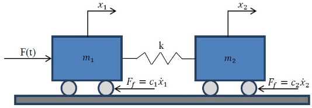

**Extracted Slide/Diagram Text:**
X2
F(t)
mi
m2
Ff= Cixi
F,= C2X2

## Slide 4: Homework

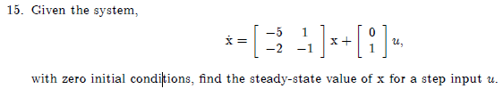

**Extracted Slide/Diagram Text:**
15. Given
the system
-5
x+
-2
conditions
with
initial
find the steady-state value of x for a step
zero
input

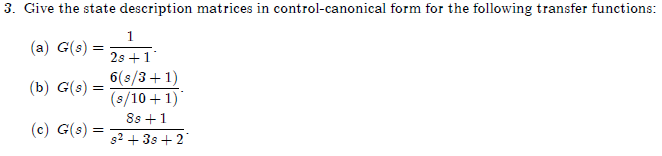

**Extracted Slide/Diagram Text:**
3. Give the state description matrices in control-canonical form for the following
transfer functions.
(a) G(s) =
2s+1
(b) G(s) =
6(s /3 + 1)
(s/10 + 1)
(c) G(s) =
8s+1
s2 + 3s + 2

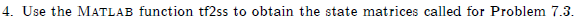

**Extracted Slide/Diagram Text:**
4. Use the MATLAB function tf2ss to obtain the state matrices called for Problem 7.3.

## Slide 5: Homework

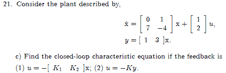

**Extracted Slide/Diagram Text:**
2l. Consider the plant described by,
x=
x+
-4
y =[ 1 3 ]x.
Find the closed-loop characteristic equation if the feedback is
(1)
K2 Jx; (2)
u = -Ki
u=-Ky.

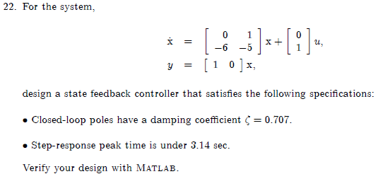

**Extracted Slide/Diagram Text:**
22. For the system
[]
design a state feedback controller that satisfies the following specifications:
Closed-loop poles have a damping coeficient  = 0.7o7.
Step-response peak time is under 3.14 sec.
Verify your design with MATLAB.

## Slide 6: Homework

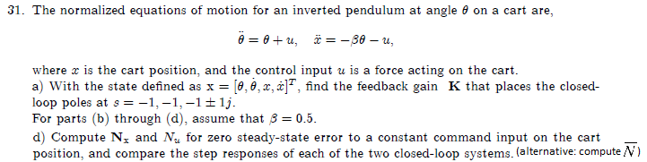

**Extracted Slide/Diagram Text:**
3l. The normalized equations of motion for an inverted pendulum at angle  on a cart are.
where r is the cart position, and the control input u is a force acting on the cart.
With the statedefined as x=[o,o,,ajT,find thefeedback gain
K that places the closed-
loop poles at s = -1,-1,-1± 1j.
For parts (b) through (d), assume that β = 0.5.
Compute Nx and N. for zero steady-state error to a constant command input on the cart
position, and compare the step responses of each of the two closed-loop systems.(alternative: compute

## Slide 7: Homework

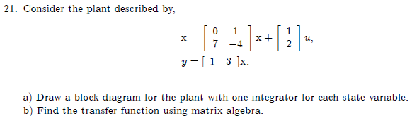

**Extracted Slide/Diagram Text:**
2l. Consider the plant described by,
x=
x+
-4
y = [ 1 3]x.
Draw a block diagram for the plant with one integrator for each state variable.
b)
Find the transfer
function
1 using matrix algebra.

## Slide 8: Homework

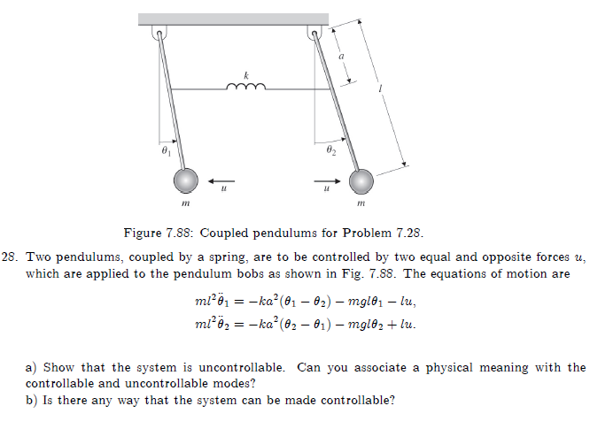

**Extracted Slide/Diagram Text:**
Figure 7.88: Coupled pendulums for Problem 7.28.
28. Two pendulums, coupled by a spring, are to be controlled by two equal and opposite forces u,
which are applied to the pendulum bobs as shown in Fig. 7.88. The equations of motion are
ml²1 = -ka?(01 - 02) - mgl1 - lu,
ml²é2 = -ka(02 - 81) - mgle2 + lu.
a) Show that the system is uncontrollable. Can you associate a physical meaning with the
controllableand uncontrollable modes?
b) Is there any way that the system can be made controllable?

## Slide 9: Homework

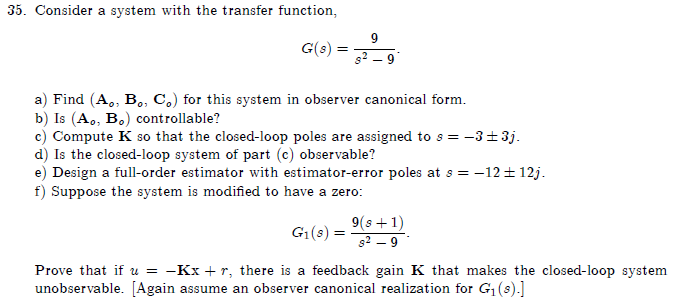

**Extracted Slide/Diagram Text:**
35. Consider a system with the transfer function,
G(s)
?-9
Find (A., B., C.) for this system in observer canonical form.
b) Is (Ao, B。) controllable?
c) Compute K so that the closed-loop poles are assigned to s = -3 ± 3j.
d) Is the closed-loop system of part (c) observable?
e) Design a full-order estimator with estimator-error poles at s = -12 ± 12j.
f) Suppose the system is modified to have a zero:
9(s + 1)
Gi(s)
Prove that if u = -Kx + r, there is a feedback gain K that makes the closed-loop system
unobservable. [Again assume an observer canonical realization for Gi (s).]

## Slide 10: Homework

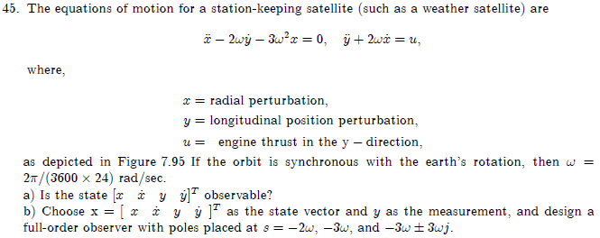

**Extracted Slide/Diagram Text:**
45. The equations of motion for a station-keeping satellite (such as a weather satellite)are
- 2wg-3wα = 0, g+ 2wi= u,
where,
r = radial perturbation,
y =longitudinal position perturbation,
u =
engine thrust in the y - direction,
as depicted in Figure 7.95 If the orbit is synchronous with the earth's rotation, then w
2π/ (3600 x 24) rad /sec.
a] Is the state [c i y y]r observable?
b) Choose x = [  i y y jT as the state vector and y as the measurement, and design a
full-order observer with poles placed at s = -2w, -3w, and -3w ± 3wj.

## Slide 11: Homework

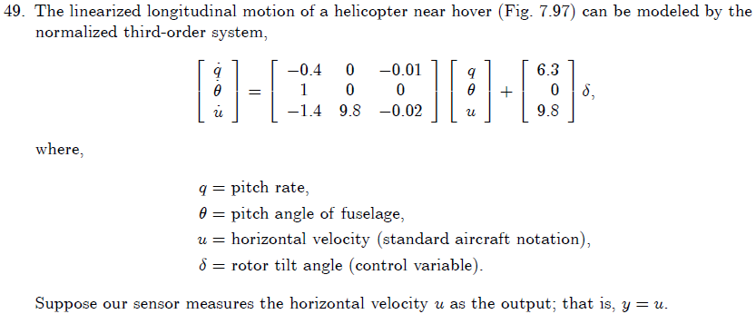

**Extracted Slide/Diagram Text:**
49. The linearized longitudinal motion of a helicopter near hover (Fig. 7.97) can be modeled by the
normalized third-order system,
-0.01
-0.4
q-
6.3
9.8
-1.4
-0.02
9.8
where,
q = pitch rate,
= pitch angle of fuselage,
u = horizontal velocity (standard aircraft notation)
S = rotor tilt angle (control variable).
Suppose our sensor measures the horizontal velocity u as the output; that is, y = u.

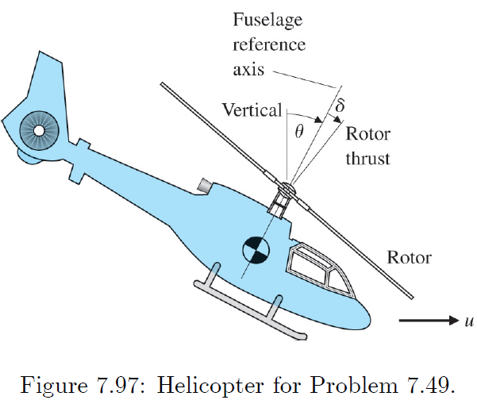

**Extracted Slide/Diagram Text:**
Fuselage
reference
axis
Vertical
Rotor
thrust
Rotor
Figure 7.97: Helicopter for Problem 7.49.

## Slide 12: Homework


**Extracted Slide/Diagram Text:**
Fuselage
reference
axis
Vertical
Rotor
thrust
Rotor
Figure 7.97: Helicopter for Problem 7.49.

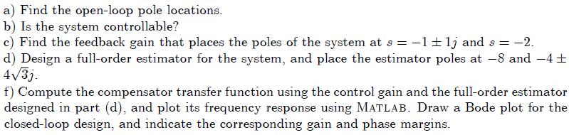

**Extracted Slide/Diagram Text:**
a)
Find the open-loop pole locations.
b) Is the system controllable?
Find the feedback gain that places the poles of the system at s = -l ± lj and s = -2.
d)
Design a full-order estimator for the system, and place the estimator poles at -8 and -4 ±
4V3j.
f) Compute the compensator transfer function using the control gain and the full-order estimator
designed in part
(d), and plot its frequency response using
MATLAB. Draw a Bode plot for the
closed-loop design, and indicate the corresponding
g gain and phase margins.

## Slide 13: Homework

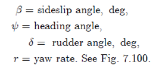

**Extracted Slide/Diagram Text:**
β = sideslip
angle, deg,
沙 = heading
angle,
rudder angle, deg,
rate. See Fig. 7.100.

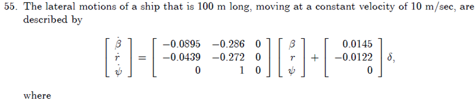

**Extracted Slide/Diagram Text:**
55. The lateral motions of a ship that is 100 m long, moving at a constant velocity of 10 m/sec, are
describedby
-0.0895
-0.286
0.0145
-0.272
-0.0439
-0.0122
where

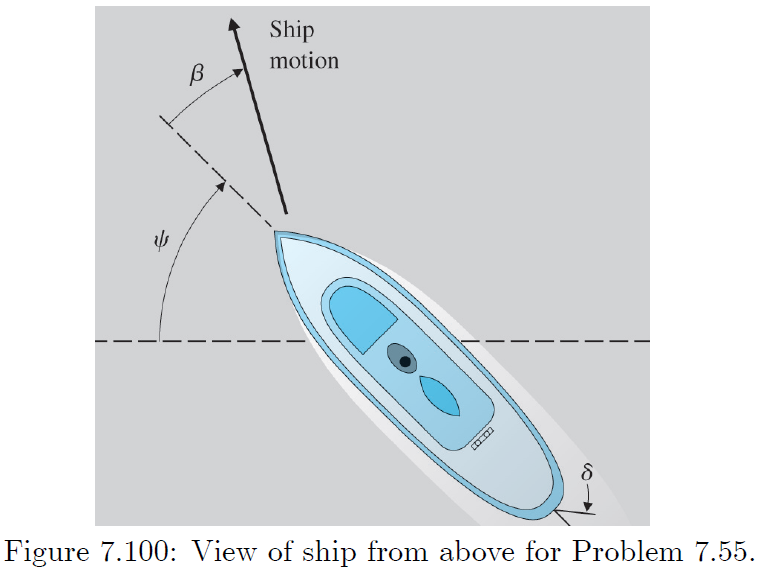

**Extracted Slide/Diagram Text:**
Ship
motion
Figure 7.100: View of ship from above for Problem 7.55.

## Slide 14: Homework

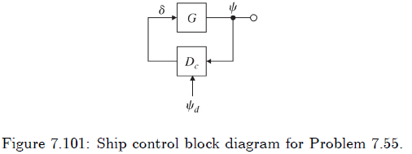

**Extracted Slide/Diagram Text:**
Figure
7.10l: Ship control block diagram for Problem 7.55.

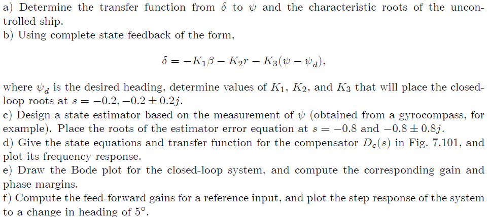

**Extracted Slide/Diagram Text:**
a) Determine the transfer function from  to  and the characteristic roots of the uncon-
trolled ship.
b) Using complete state feedback of the form,
= -Kiβ- K2r-K(-d);
where d is the desired heading, determine values of Ki, K2. and K3 that will place the closed-
loop roots at s = -0.2, -0.2 ± 0.2j.
c) Design a state estimator based on the measurement of z (obtained from a gyrocompass, for
example). Place the roots of the estimator error equation at s = -0.8 and -0.8 ± 0.8j.
d) Give the state equations and transfer function for the compensator De(s) in Fig. 7.1ol, and
plot its frequency response.
e) Draw the Bode plot for the closed-loop system, and compute the corresponding gain and
phase margins.
f) Compute the feed-forward gains for a reference input, and plot the step response of the system
to a change in heading of 5°


**Extracted Slide/Diagram Text:**
Ship
motion
Figure 7.100: View of ship from above for Problem 7.55.

## Slide 15: Homework

```matlab
Search a model in the book (transfer function or state-space) that is interesting for you
Implement the Autonomous Estimator using Simulink, which includes
Only the output measurement is available
State estimation
Full-state feedback using estimated states
Reference tracking
No answers will be supplied for this homework but it is very useful for the exam.
```

## Slide 16: Homework

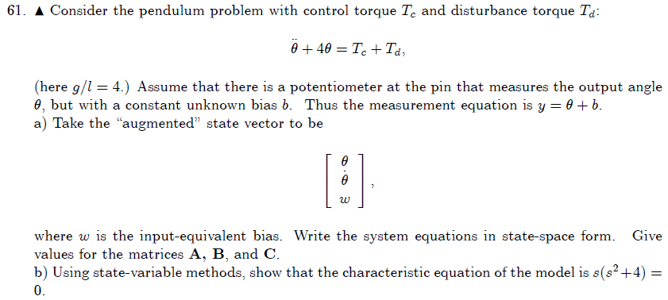

**Extracted Slide/Diagram Text:**
6l. ^ Consider the pendulum problem with control torque Te and disturbance torque Ta:
+40=Tc+Ta
(here g/l = 4.) Assume that there is a potentiometer at the pin that measures the output angle
O, but with a constant unknown bias b. Thus the measurement equation is y =  + b.
a) Take the “augmented" state vector to be
where w is the input-equivalent bias. Write the system equations in state-space form.
Give
values for the matrices A, B, and C.
b) Using state-variable methods, show that the characteristic equation of the model is s(s? +4) =

## Slide 17: Homework

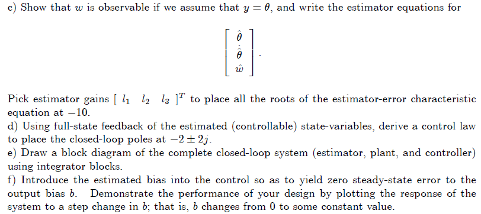

**Extracted Slide/Diagram Text:**
c) Show that w is observable if we assume that y = , and write the estimator equations for
Pick estimator gains [ li l2 l3 jT to place all the roots of the estimator-error characteristic
equation at -10.
d) Using full-state feedback of the estimated (controllable) state-variables, derive a control law
to place the closed-loop poles at -2 ± 2j.
e) Draw a block diagram of the complete closed-loop system (estimator, plant, and controller)
using integrator blocks.
f) Introduce the estimated bias into the control so as to yield zero steady-state error to the
output bias b. Demonstrate the performance of your design by plotting the response of the
system to a step change in b; that is, b changes from 0 to some constant value.

