# OBS7 Lecture Slides

## Slide 1

## Slide 2

## Slide 3

## Slide 4: Observers for State Space Systems OBS7 Lecture 1-2: Introduction to State Space, Stability, Hurwitz, Eigenvalues, Eigenvectors

## Slide 5


**Extracted Slide/Diagram Text:**
Important Equations in Chapter 7
Name
Equation
Page
-a1
-a2
-an
[1]
Controlcanonicalform
Ac
Bc
Lo
Cc =[
b1
b2
bn
Dc = 0.
State description
× = Ax +Bu
Output equation
y = Cx+ Du
Transformation of state
A = T-1AT
B= T-1B
y = CTz + Du = Cz + Du,
where ℃ = CT, D = D
Controllability matrix
C= [B
AB
An-1B)
Transfer function from
Y(s)
G(s) =
:C(sI - A)-1B + D
state equations
U(s)
Transfer-function poles
det(piI - A) = 0
ziI - A
Transfer-function zeros
-B
αz(s) = det
:0
Control characteristic
det[sI - (A - BK)] = 0
equation

## Slide 6

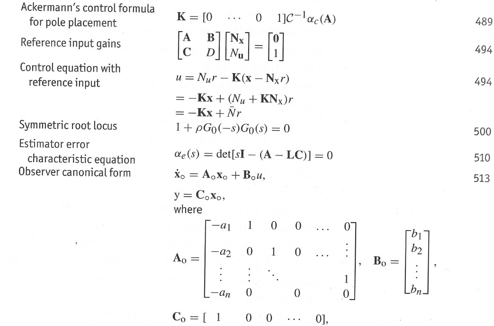

**Extracted Slide/Diagram Text:**
Ackermann's controlformula
K= [0
1)C-1αc(A)
for pole placement
[Nx
Reference input gains
Nu
Control equation with
u = Nur -K(x-Nxr)
reference input
= -Kx+(Nu+KNx)r
=-Kx+Nr
Symmetric root locus
1 + pGo(-s)Go(s) = 0
Estimator error
αe(s) = det[sI - (A - LC)] = 0
characteristic equation
Observer canonical form
X。 = AoX。 + Bou,
y = Coxo,
where
LO
[b1]
-a2
b2
Ao
Bo
Lbn-
-an
Co=［1
0],

## Slide 7


**Extracted Slide/Diagram Text:**
[c
CA
Observability matrix
LO-
Ackermann'sestimator
L = αe(A)O-1
formula
U(s)
Compensator transfer
-K(sI - A + BK +LC)-1L
Dc(s)
function
Y(s)
U(s)
Reduced-order compensator
Cr(sI - Ar)-1Br +Dr
Dcr(s)
Y(s)
transfer function
= (A -BK- LC)+Ly + Mr
Controller equations
-Kx+ Nr

## Slide 8

Information about the teacher

Name:		Albert Aslan
E-mail:		a.aslan@fontys.nl
Room:		R1_0.173


**Extracted Slide/Diagram Text:**
TU/e
TU/e
TU/e
TU/e
TUe
TU/e
TU/e
TU/e
TU/e
TU/e
HAJRAA
HAJRAA
HAJRAA
HAJRAA
HAJRAA
HAJRAA
HAJRAA
HAJRAA
HAJRAA
HIRAA
HAJRAA

## Slide 9

Overall information 1

Course name:		OBS7
Scope:			4 ECTS
Materials:		-Handouts Powerpoint
-Mandatory: "Feedback Control of 				Dynamic Systems, Global Edition" 				from Gene F. Franklin e.a. (7th edition),  			ISBN13: 9781292068909

## Slide 10

Overall information 2

Lectures: 		2x2 hours for 6 weeks
Exam:			Digital exam for 100 min. 					About the whole course
Practicals:		2 sessions (except week 3,5 or week 4,6) 			as half class (attendance mandatory for 			the ones with Quanser setups)
Must be graded satisfactory for the full 			allocation of the course credits
Allowed in exam:	Open book (not your own notes)
A calculator, MATLAB/Simulink and 			your own computer,
Any means of online communication will result in disciplinary actions.

## Slide 11: Planning

| Week | Topic | Study material |
| --- | --- | --- |
| 1 | Introduction to State Space,  Matrix Calculations,  Stability, Hurwitz, eigenvalues, eigenvectors | Chp. 7.1, 7.2 Appendix WB (see fpe7e.com) 7.4.1 (pp. 473-477) |
| 2 | State Feedback Control  Pole placement,  Introducing the Reference Input Control | 7.5, 7.5.1 7.6, 7.6.1 7.5.2 (pp. 493-497) |
| 3 | Canonical forms Controllability, Observability | 7.3, 7.4.1 (pp. 462-470) 7.4.1 (pp 470-472) |
| 4 | Luenberger Observer and  Stability of Observer | 7.7, 7.7.1 7.7.3 |
| 5 | State Feedback Control Using the Observed States Introduction of the Reference Input with the Observer | 7.8 7.9 |
| 6 | The disturbance (augmented/extended) observer, Exam preparation | 7.10.4 |

## Slide 12: Introduction

What is an observer?
Why do we need an observer?
Let’s watch a video
https://nl.mathworks.com/videos/understanding-kalman-filters-part-1-why-use-kalman-filters--1485813028675.html

## Slide 13: STATE SPACE SYSTEMS

The state equation and the output equation of a linear system can be written as matrices:

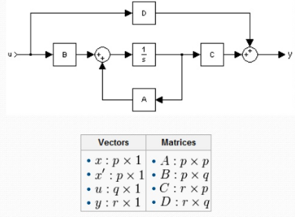

**Extracted Slide/Diagram Text:**
Vectors
Matrices
r:p×1
.A:pxp
a:px1.B:pxq
u:gx1
.C:rxp
D:rxq

## Slide 14: Matrix recap

## Slide 15: Matrix recap

## Slide 16: Matrix recap

## Slide 17: Matrix recap - Product

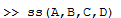

**Extracted Slide/Diagram Text:**
>> 33(A,B,c,d)


## Slide 18: Matrix recap - Transpose

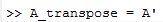

**Extracted Slide/Diagram Text:**
>> A_transpose = A'

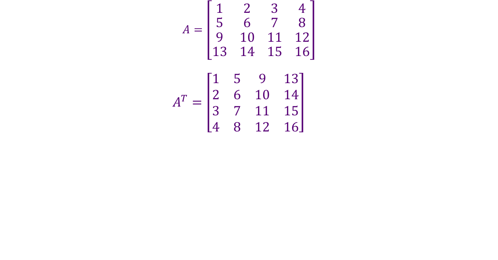

## Slide 19: Matrix recap - Determinant


**Extracted Slide/Diagram Text:**
>> det(1)

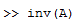

**Extracted Slide/Diagram Text:**
>> inv(A)

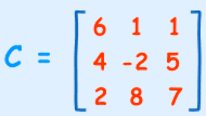

**Extracted Slide/Diagram Text:**
+-2 5
2 8

## Slide 20: Matrix recap - Determinant

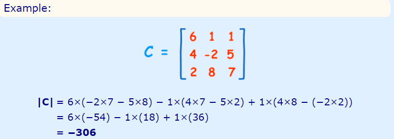

**Extracted Slide/Diagram Text:**
Example:
4 -2
ICl = 6×(-2×7 - 5×8) - 1×(4×7 - 5×2) + 1×(4×8 - (-2×2))
= 6×x(-54) - 1×(18) + 1×(36)
= -306

## Slide 21: Matrix recap - Determinant

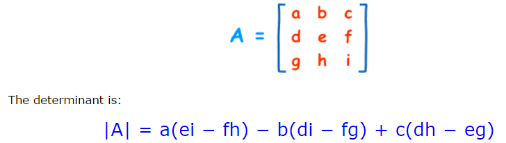

**Extracted Slide/Diagram Text:**
The determinant is:
= a(ei - fh) - b(di - fg)
c(dh - eg)


**Extracted Slide/Diagram Text:**
>> det(1)

## Slide 22: Matrix recap - Rank

The rank of a matrix is the number of its linearly independent rows or columns.


**Extracted Slide/Diagram Text:**
>> det(1)

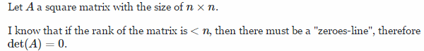


**Extracted Slide/Diagram Text:**
>> rank(A)

## Slide 23: Matrix recap - Rank

The rank of a matrix is the number of its linearly independent rows or columns.


**Extracted Slide/Diagram Text:**
>> det(1)


**Extracted Slide/Diagram Text:**
>> rank(A)

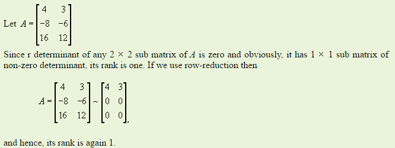

**Extracted Slide/Diagram Text:**
Let A =-8
-6
Since r determinant of any 2 × 2 sub matrix of A is zero and obviously, it has 1 × 1 sub matrix of
non-zero determinant, its rank is one. If we use row-reduction then
A=-8
一6
and hence, its rank is again 1.

## Slide 24: Matrix recap – Characteristic Polynomial


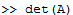

**Extracted Slide/Diagram Text:**
>> det(1)

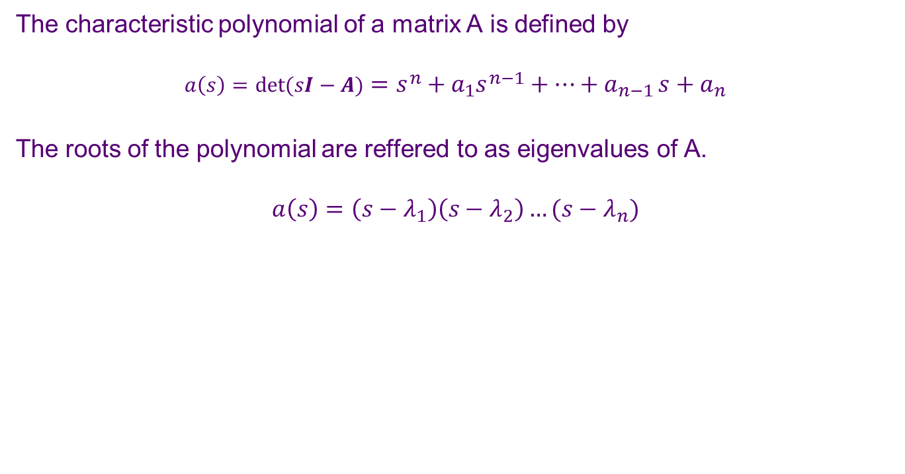

**Extracted Slide/Diagram Text:**
The characteristic polynomial of a matrix A is defined by
a(s) = det(sl - A) = sn + aisn-1 + .. + an-1 s + an
The roots of the polynomial are reffered to as eigenvalues of A
(S)=(S-2)(S-A2).(S-Am


**Extracted Slide/Diagram Text:**
>> charpoly(A,x)

## Slide 25: Matrix recap – Eigenvalues & Eigenvectors


**Extracted Slide/Diagram Text:**
>> det(1)

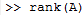

**Extracted Slide/Diagram Text:**
>> rank(A)

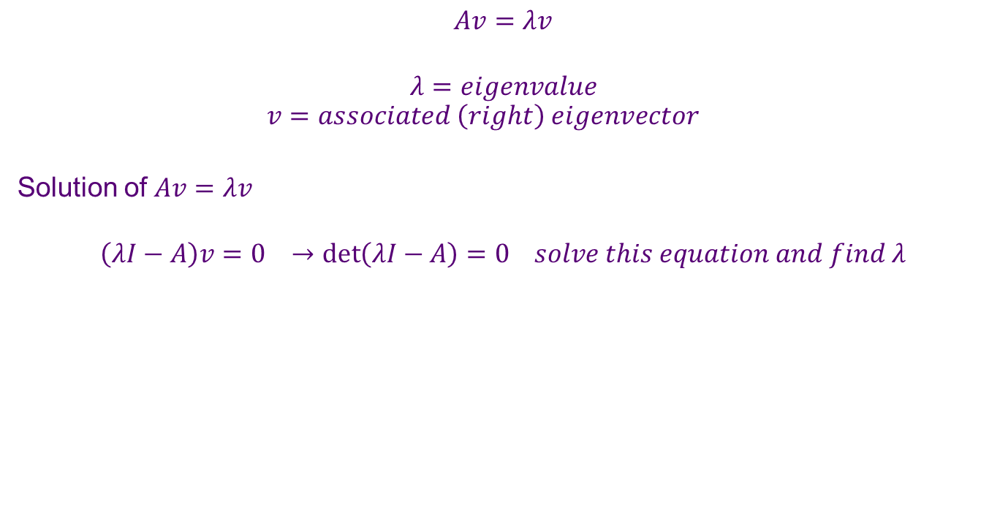

**Extracted Slide/Diagram Text:**
AV=W
N=eigenvalue
v= associated righteigenvector
SolutionofAv=Av
AV=0-dct-A=0
solve this eguation and find a


**Extracted Slide/Diagram Text:**
>> [v,d]=eig(A)

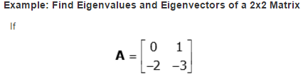

**Extracted Slide/Diagram Text:**
Example: Find
Eigenvalues and
Eigenvectors of a 2x2 Matrix
If
A=
-2
-3

## Slide 26: Matrix recap – Eigenvalues & Eigenvectors


**Extracted Slide/Diagram Text:**
>> det(1)


**Extracted Slide/Diagram Text:**
>> rank(A)

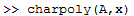

**Extracted Slide/Diagram Text:**
>> charpoly(A,x)


**Extracted Slide/Diagram Text:**
>> [v,d]=eig(A)

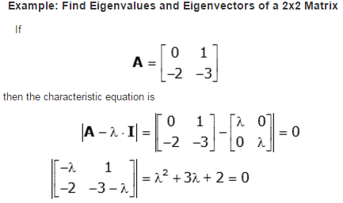

**Extracted Slide/Diagram Text:**
Example:FindEigenvaluesandEigenvectorsofa2x2Matrix
If
A=
-2
-3
then the characteristic equation is
IA -  ·I| =
=0
-2
-3
= 22 + 3 + 2 = 0
1-2
-3-入

## Slide 27: Matrix recap – Eigenvalues & Eigenvectors


**Extracted Slide/Diagram Text:**
>> det(1)


**Extracted Slide/Diagram Text:**
>> rank(A)


**Extracted Slide/Diagram Text:**
>> charpoly(A,x)


**Extracted Slide/Diagram Text:**
>> [v,d]=eig(A)

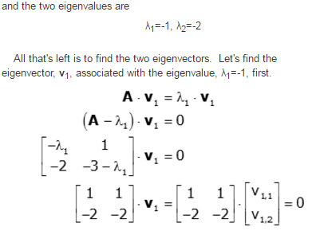

**Extracted Slide/Diagram Text:**
and the two eigenvalues are
Aμ=-1, Λ2=-2
All that's left is to find the two eigenvectors. Let's find the
eigenvector, Vi, associated with the eigenvalue, A,=-1, first.
A . V, = , - V,
(A -2) - V1 = 0
-3 -21
Vi = 0
-2
1,1
V:
=0
-2
-2
-2
N1.2

## Slide 28: Matrix recap – Eigenvalues & Eigenvectors


**Extracted Slide/Diagram Text:**
>> det(1)


**Extracted Slide/Diagram Text:**
>> rank(A)


**Extracted Slide/Diagram Text:**
>> charpoly(A,x)


**Extracted Slide/Diagram Text:**
>> [v,d]=eig(A)

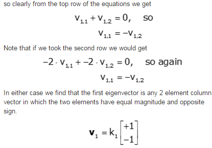

**Extracted Slide/Diagram Text:**
so clearly from the top row of the equations we get
V1.1 + V1,2 = 0,
V1,1 = V1,2
Note that if we took the second row we would get
-2 - V1,1 + 2 - V1.2 = 0,
so again
V1,1 = -V1,2
In either case we find that the first eigenvector is any 2 element column
vector in which the two elements have egual magnitude and opposite
sign.

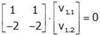

**Extracted Slide/Diagram Text:**
1,1
1,2

## Slide 29: Matrix recap – Eigenvalues & Eigenvectors

## Slide 30: Matrix recap – Eigenvalues & Eigenvectors

## Slide 31: Stability in State Space

## Slide 32: Assignment

```matlab
Write a Matlab function isStable(A,B,C,D)
that returns the boolean value (true or false) if the system is stable.
```

## Slide 33: Assignment

```matlab
function [ boolean ] = isStable( A,B,C,D)
E = eig(A);
positive_eigenvalues = E(E>0);
if any(positive_eigenvalues) == 1
boolean = 0;
else
boolean = 1;
end
end
```

## Slide 34: Deriving the state space model


**Extracted Slide/Diagram Text:**
y(t)

What is the input and output?
What are the differential equations
What is the order?
Which state vector should be defined?

Next, express the differential equation using only state variables and input/output variables.

## Slide 35: Deriving the state space model

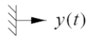

**Extracted Slide/Diagram Text:**
y(t)

Next, express the differential equation using only state variables and input/output variables.

Always answer the following questions first:

## Slide 36

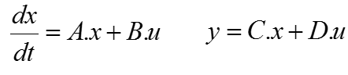

**Extracted Slide/Diagram Text:**
dx
A.x+ Bu
C.x + D.

## Slide 37: How to formulate state space systems?

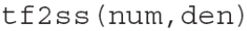

**Extracted Slide/Diagram Text:**
num


## Slide 38: How to formulate state space systems?


**Extracted Slide/Diagram Text:**
num


## Slide 39: How to formulate state space systems?


**Extracted Slide/Diagram Text:**
tf2ss
(num, den)

## Slide 40: How to formulate state space systems?


**Extracted Slide/Diagram Text:**
tf2ss
(num, den)

## Slide 41: How to formulate state space systems?


**Extracted Slide/Diagram Text:**
tf2ss
(num, den)

## Slide 42: How to formulate state space systems?


**Extracted Slide/Diagram Text:**
tf2ss
(num, den)

## Slide 43: How to formulate state space systems?


**Extracted Slide/Diagram Text:**
tf2ss
(num, den)

## Slide 44: How to formulate state space systems?

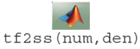

**Extracted Slide/Diagram Text:**
tf2ss
(num, den)

## Slide 45: How to formulate state space systems?


**Extracted Slide/Diagram Text:**
tf2ss
(num, den)

## Slide 46

## Slide 47: How to formulate TF from SS?


**Extracted Slide/Diagram Text:**
>> 3s2tf(A,B,C,D)


## Slide 48: How to formulate TF from SS?


**Extracted Slide/Diagram Text:**
>> 3s2tf(A,B,C,D)


## Slide 49: How to formulate TF from SS?

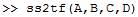

**Extracted Slide/Diagram Text:**
>> 3s2tf(A,B,C,D)


## Slide 50: How to formulate TF from SS?

## Slide 51: Homework

Find the state space representation of the following two cart system with friction on the wheels.


**Extracted Slide/Diagram Text:**
X2
F(t)
mi
m2
Ff= Cixi
F,= C2X2

## Slide 52: Homework

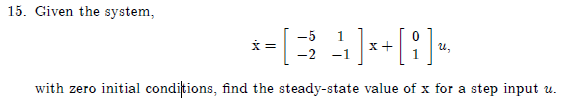

**Extracted Slide/Diagram Text:**
15. Given
the system
-5
x+
-2
conditions
with
initial
find the steady-state value of x for a step
zero
input

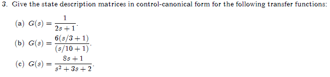

**Extracted Slide/Diagram Text:**
3. Give the state description matrices in control-canonical form for the following
transfer functions.
(a) G(s) =
2s+1
(b) G(s) =
6(s /3 + 1)
(s/10 + 1)
(c) G(s) =
8s+1
s2 + 3s + 2

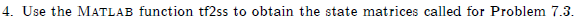

**Extracted Slide/Diagram Text:**
4. Use the MATLAB function tf2ss to obtain the state matrices called for Problem 7.3.

## Slide 53: List of resources

http://lpsa.swarthmore.edu/MtrxVibe/EigMat/MatrixEigen.html
https://nl.mathworks.com/matlabcentral/answers/136427-pid-gains-from-a-transfer-function-of-a-mass-spring-damper-system
Feedback Control of Dynamic Systems, 7th edition, Franklin et. al. Global Edition. Pearson.
http://www.mathsisfun.com/algebra/matrix-determinant.html
https://en.wikipedia.org/wiki/Hurwitz_matrix

## Slide 54: OBS7 Lecture 3: State Feedback Control and Pole Placement

## Slide 55: Planning

| Week | Topic | Study material |
| --- | --- | --- |
| 1 | Introduction to State Space,  Matrix Calculations,  Stability, Hurwitz, eigenvalues, eigenvectors | Chp. 7.1, 7.2 Appendix WB (see fpe7e.com) 7.4.1 (pp. 473-477) |
| 2 | State Feedback Control  Pole placement,  Introducing the Reference Input Control | 7.5, 7.5.1 7.6, 7.6.1 7.5.2 (pp. 493-497) |
| 3 | Canonical forms Controllability, Observability | 7.3, 7.4.1 (pp. 462-470) 7.4.1 (pp 470-472) |
| 4 | Luenberger Observer and  Stability of Observer | 7.7, 7.7.1 7.7.3 |
| 5 | State Feedback Control Using the Observed States Introduction of the Reference Input with the Observer | 7.8 7.9 |
| 6 | The disturbance (augmented/extended) observer, Exam preparation | 7.10.4 |

## Slide 56: Homework (Solutions)

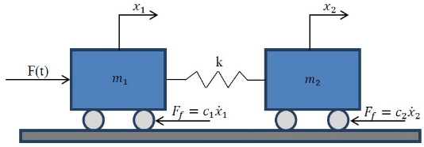

**Extracted Slide/Diagram Text:**
X2
F(t)
mi
m2
Ff= Cixi
F,= C2X2

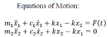

**Extracted Slide/Diagram Text:**
Equations of Motion:
m+c+kx-kx2
Ft)
m2x2+C2x2+kx2
-kxi

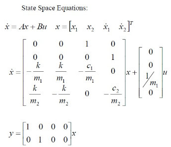

**Extracted Slide/Diagram Text:**
State SpaceEquations:
=A+Bu =[
x+

## Slide 57: Homework (Solutions)

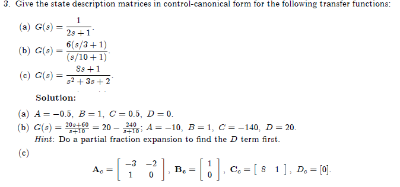

**Extracted Slide/Diagram Text:**
3. Give the state description matrices in control-canonical form for the following transfer functions:
G(8)
2s+1'
6(s/3+1)
(b)
G(3)
(s/10 + 1)
(c) G(s) = 2 + 3s + 2
8s +1
Solution:
(a) A = -0.5, B = 1, C = 0.5, D = 0.
(b) G(s) :
203+60
3+10
Hint: Do a partial fraction expansion to find the D term first.
(c)
-3
-2
Ac
Bc=

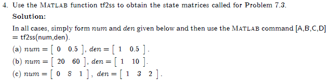

**Extracted Slide/Diagram Text:**
4. Use the MIATLAB
function tf2ss to obtain the state matrices called for Problem 7.3.
Solution:
In all cases, simply form num and den given below and then use the MATLAB command [A,B,C,D]
= tf2ss(num,den),
(a)
0.5.den =
0.51
(b)
60 . den =
(c)
1 den=

## Slide 58: Homework (Solutions)

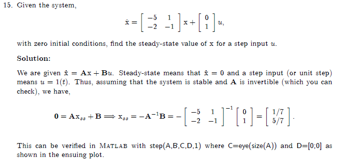

**Extracted Slide/Diagram Text:**
15. Given the system,
x+
-2 -1
with zero initial conditions, find the steady-state value of x for a step input u.
Solution:
We are given x = Ax +Bu. Steady-state means that x = O and a step input (or unit step)
means u = 1(t). Thus, assuming that the system is stable and A is invertible (which you can
check), we have,
- [9]=[/]
0=Axg: +BXss =-A-1B=
-2
This can be verified in MATLAB with step(A,B,C,D,1) where C=eye(size(A)) and D=[0;0])
as
shown in the ensuing plot.

## Slide 59: Homework (Solutions)

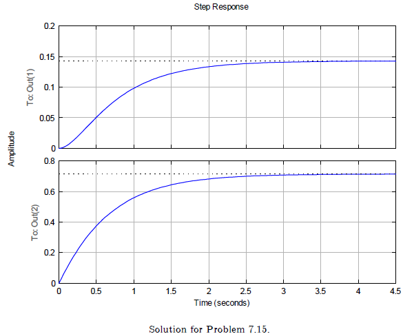

**Extracted Slide/Diagram Text:**
Step Response
0.15
:Out(1)
0.1
0.05
Amplitude
0.8
0.6
To: Out(2)
0.4
0.2
0.5
1.5
2.5
3.5
4.5
Time (seconds)
Solution for Problem 7.15

## Slide 60: Full-state feedback

The purpose: Assign a set of pole locations
(aim for good rise-time, settling-time, overshoot, and steady state error)
Assumption: we have access to all the states (i.e. accelerometer, tachometer, position encoder are all available)

## Slide 61: Recap- root locus (limited freedom of pole locations)

## Slide 62: Full-state Feedback Control (chapter 7.5)

Compare this block diagram with output feedback. Which one can perform better?


**Extracted Slide/Diagram Text:**
R(s)
C(s)
Hp(s)

Output feedback

State feedback

## Slide 63: Full-state Feedback Control (chapter 7.5)

Compare this block diagram withoutput feedback. Which one can perform better?

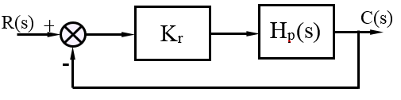

**Extracted Slide/Diagram Text:**
R(s)
C(s)
Hp(s)

Output feedback

State feedback

## Slide 64: Full-state Feedback Control (chapter 7.5)

Each state has its own K, more effect on the poles, more freedom

## Slide 65: Full-state Feedback Control (chapter 7.5)

Each state has its own K, more effect on the poles, more freedom

Note that: reference = 0

## Slide 66: Explanation: full-state feedback vs. reality

“We assume for feedback purposes that all the elements of the state vector are at our disposal which is why we refer to this as “full-state,” feedback. In practice, of course, this would usually be a ridiculous assumption; moreover, a well-trained control designer knows that other design methods do not require so many sensors. The assumption that all state-variables are available merely allows us to proceed with this first step.”

## Slide 67: Analysis of full-state feedback

## Slide 68: Analysis of full-state feedback

## Slide 69: Analysis of full-state feedback

## Slide 70: Analysis of full-state feedback

## Slide 71: Example: Full state feedback

## Slide 72: Example: Full state feedback


**Extracted Slide/Diagram Text:**
D* u
Gain9
B* u
Constant
Integr ator 1
Gain8
GainB
output
Gain5
A*
states


**Extracted Slide/Diagram Text:**
andino
states
-10
-30
-40
Ready
T=10.000


**Extracted Slide/Diagram Text:**
andno
states
-10
-30
-40

## Slide 73: Example: Full state feedback

Since the system is stable, all the states and output returns to 0 after some time. (because ref=0)
Let’s place the poles to    -4, -5, and -6 for faster reaction, K=?


**Extracted Slide/Diagram Text:**
andno
states
-10
-30
-40

## Slide 74: Example: Full state feedback


**Extracted Slide/Diagram Text:**
D* u
Gain4
B* u
Integrator
Gain3
Gain1
output
Gain
A*
Gain2
states
-K*u

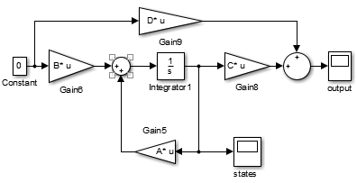

**Extracted Slide/Diagram Text:**
D* u
Gain9
B* u
Constant
Integr ator 1
Gain8
GainB
output
Gain5
states

## Slide 75: Example: Full state feedback

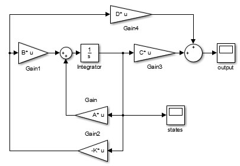

**Extracted Slide/Diagram Text:**
D* u
Gain4
B* u
Integrator
Gain3
Gain1
output
Gain
A*
Gain2
states
-K*u

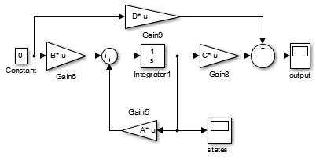

**Extracted Slide/Diagram Text:**
D* U
Gaing
B* u
Constant
Integr ator 1
Gain8
GainB
output
Gain5
states

## Slide 76: Example: Full state feedback

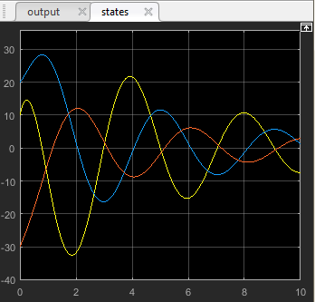

**Extracted Slide/Diagram Text:**
andno
states
-10
-30
-40

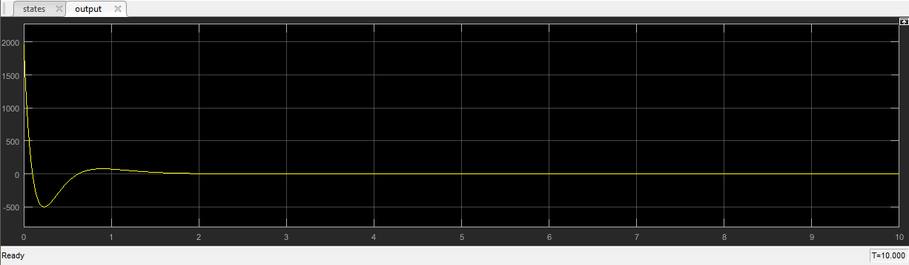

**Extracted Slide/Diagram Text:**
states
andino
Ready
T=10.000

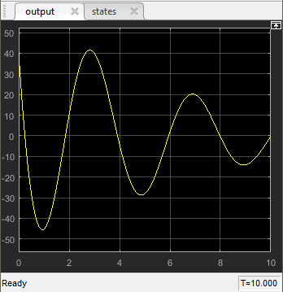

**Extracted Slide/Diagram Text:**
andino
states
-10
-30
-40
Ready
T=10.000

Before state fb

Before state fb

After state feedback

After state feedback

## Slide 77: Example: Full state feedback

## Slide 78

“Selecting desirable root locations is an inexact science that may require some iteration by the designer.”

## Slide 79: Assignment (Example 7.14, given the pole locations)

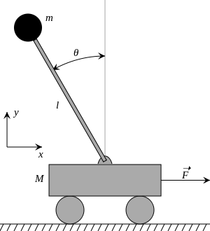

## Slide 80: Assignment solutions

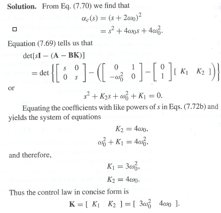

**Extracted Slide/Diagram Text:**
Solution. From Eq.(7.70)we find that
αc(s) = (s + 200)2
= s2 + 400s + 40.
Equation (7.69) tells us that
det[sI - (A - BK)]
(- ]-[] i k2)]
= det
J0
s2 + K2s + o + K1 = 0.
Equating the coefficients with like powers of s in Eqs. (7.72b) and
yields the system of equations
K2 = 400,
+ K1 = 40
and therefore,
K1 = 300,
K2 = 400.
Thus the control law in concise form is
K=[KiK2 ] =[3
400 1.

## Slide 81

```matlab
Matlab code to simulate state space responses
A=[0 1;-1 0];  B=[0;1];
C=[1 0];       K=[3 4];
Acl=A-B*K;
t=0:0.1:7;
sysCL = ss(Acl,[0;0],[C;0 1;-K/4],0);
y2 = lsim(sysCL,zeros(length(t),1)',t,[1;0]);
figure; plot(t,y2,'LineWidth',2)
xlabel('Time (sec)');
ylabel('Amplitude');
text(1.7,-.3,'x_2');
text(.5,.1,'u/4');
text(.7,.7,'x_1');
title('Free response of the oscillator with full state feedback');
grid;
```

## Slide 82: Ackermann’s Formula, Pole Placement

## Slide 83: Ackermann’s Formula, Pole Placement

## Slide 84: Ackermann’s Formula, Pole Placement

## Slide 85: Ackermann’s Formula: The main algorithm

## Slide 86: Ackermann’s Formula: Example

## Slide 87: Ackermann’s Formula: Example (Solutions)

## Slide 88: Ackermann’s Formula: Example (Solutions)

## Slide 89: Ackermann’s Formula: Example (Solutions)

## Slide 90: Ackermann’s Formula: Example (Solutions)

## Slide 91: Ackermann’s Formula: Example (Solutions)

## Slide 92: Ackermann’s Formula: in MATLAB

```matlab
In MATLAB the three steps of Ackermann’s formula can be implemented easily.
>> wo = 1;
>> A = [ 0 1; -wo*wo 0];
>> B = [0;1];
>> desired_poles = [-2*wo;-2*wo];
>> K = acker(A,B,desired_poles)
K =
3     4
```


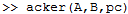

**Extracted Slide/Diagram Text:**
>> acker(A,B,pc)

## Slide 93: Ackermann’s Formula: in MATLAB


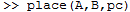

**Extracted Slide/Diagram Text:**
>> place(A,B,pc)

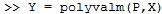

**Extracted Slide/Diagram Text:**
>> Y = polyvalm(P,X)


## Slide 94: Controllability

In rare instances the system may be uncontrollable, in which case no possible control will yield arbitrary pole locations. Uncontrollable systems have certain modes, or subsystems, that are unaffected by the control.

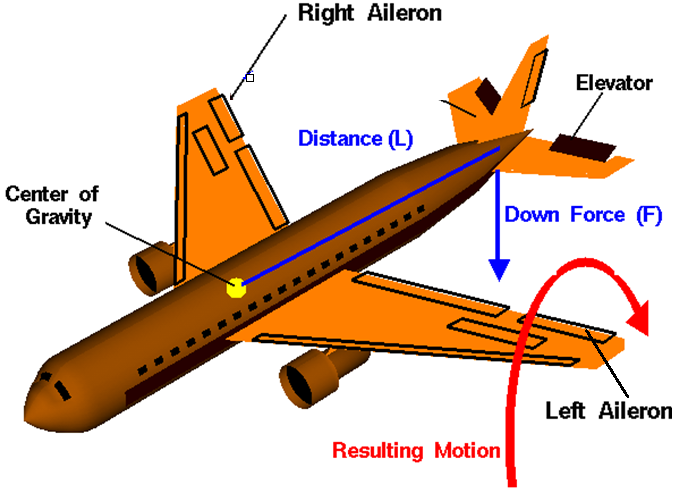

**Extracted Slide/Diagram Text:**
Right Aileron
Elevator
Distance (L)
Center of
Gravity
Down Force
(F)
Left Aileron
Resulting Motion

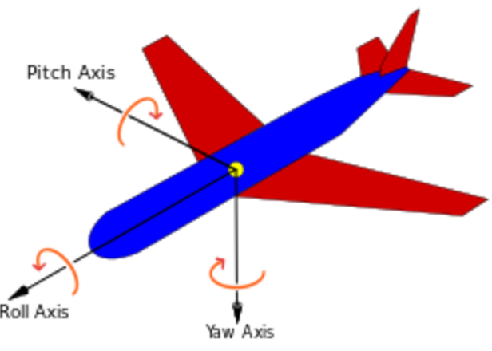

**Extracted Slide/Diagram Text:**
Pitch Axis
Roll Axis
Yaw Axis

Parts of the system are physically disconnected

## Slide 95: Controllability

## Slide 96: Controllability – state space

How do we recognize it from numbers and matrices?
Consider the following numerical example
This system has two roots (3 and -2) and hence unstable due to positive pole at 3.
The control effort exists only for the unstable mode (+3), that’s why the system is uncontrollable (but stabilizable).
Uncontrollable = you can’t place all the poles to wherever you want

## Slide 97: Controllability matrix

## Slide 98: Controllability – Example

## Slide 99: Controllability – Example (solution)

## Slide 100: Controllability – Example (solution)

## Slide 101


Controllable

Almost uncontrollable

Uncontrollable
(extra actuation needed, like abs)

## Slide 102: Summary Pole Placement

## Slide 103: Assigment

## Slide 104: Homework


**Extracted Slide/Diagram Text:**
2l. Consider the plant described by,
x=
x+
-4
y =[ 1 3 ]x.
Find the closed-loop characteristic equation if the feedback is
(1)
K2 Jx; (2)
u = -Ki
u=-Ky.


**Extracted Slide/Diagram Text:**
22. For the system
[]
design a state feedback controller that satisfies the following specifications:
Closed-loop poles have a damping coeficient  = 0.7o7.
Step-response peak time is under 3.14 sec.
Verify your design with MATLAB.

## Slide 105: OBS7 Lecture 4: Reference Input with Full-State Feedback

## Slide 106: Planning

| Week | Topic | Study material |
| --- | --- | --- |
| 1 | Introduction to State Space,  Matrix Calculations,  Stability, Hurwitz, eigenvalues, eigenvectors | Chp. 7.1, 7.2 Appendix WB (see fpe7e.com) 7.4.1 (pp. 473-477) |
| 2 | State Feedback Control  Pole placement,  Introducing the Reference Input Control | 7.5, 7.5.1 7.6, 7.6.1 7.5.2 (pp. 493-497) |
| 3 | Canonical forms Controllability, Observability | 7.3, 7.4.1 (pp. 462-470) 7.4.1 (pp 470-472) |
| 4 | Luenberger Observer and  Stability of Observer | 7.7, 7.7.1 7.7.3 |
| 5 | State Feedback Control Using the Observed States Introduction of the Reference Input with the Observer | 7.8 7.9 |
| 6 | The disturbance (augmented/extended) observer, Exam preparation | 7.10.4 |

## Slide 107: Homework (Solutions)


**Extracted Slide/Diagram Text:**
21. Consider the plant described by,
×=[9 24]++[3]
y=[ 1 3 ]x.
c) Find the closed-loop characteristic equation if the feedback is
(1) u= -[ Ki K² ]x; (2) u= -Ky.
Solution:
(c)
(i) State feedback, u = -[Ki K2]x.
^+Ki
-1+ K2
det(I- A +BK) =
det
-7+2K² +4+2K2
^² +>(4 + 2K2 + K1) + (6Ki +7K2 - 7) = 0.
(ii) Output feedback,
u=-Ky=-K[1 3]x=-[ 3K]x.
This yields the following closed-loop characteristic equation:
? + X(7K +4) + (27K - 7) = 0.
Hints: If you have already solved the case for state feedback, simply plug Ki = K and K2 = 3K
into the characteristic equation for state feedback and find the characteristic equation for output
feedback. The output vector C fixes the ratio among the state variables. Secondly, although
there were products of Ki and K2 when we were forming the determinant, they should all cancel
in your final answer. The reason for this is that the characteristic equation x = (A - BK)x is
linear in K.

## Slide 108: Homework (Solutions)


**Extracted Slide/Diagram Text:**
22. For the system,
-6
-5
0x,
design a state feedback controller that satisfies the following specifications:
Closed-looppoles haveadamping coeficient=0.707.
Step-responsepeaktimeisunder3.14sec.
Verify your design with MATLAB.
Solution:
For a second-order system, the specification on rise time can be translated into a value of wnby
the equation Wd = π. Then determine wn from wd = wn V1 -. This yields Wn = 1.414.
Using full state feedback, we would like the a characteristic equation to be,
s² + 26wns +w = s² + 2s +2 = 0.

## Slide 109: Homework (Solutions)


**Extracted Slide/Diagram Text:**
Using state feedback u = -Kx, we get,
x= (A-BK)x=
-5-k2
6-k1
x.
Hencethe closed-loop characteristic equation is,
g? + (5 + k2) s + (6 + k1) = 0.
Comparing coeficients, ki = -4 and k2 = -3. The MATLAB command place can also be used.
The reference step can be simulated in MATLAB with u = -Kx +r, and the MATLAB command
step, as shown below.


**Extracted Slide/Diagram Text:**
Step Response
0.7
0.6
0.5
Amplitude
0.3
0.2
0.1
Time (sec)
Step response for Problem 7.22.

## Slide 110

So far we have looked at how to pick K to get the dynamics to have some nice properties (i.e. stabilize A)
The question remains as to how well this controller allows us to track a reference command?
Performance issue rather than just stability.

10/lecture-notes/MIT16_30F10_lec11.pdf

## Slide 111: Basic pole placement


**Extracted Slide/Diagram Text:**
D* u
Gain4
B* U
Integrator
Gain3
Gain1
ndno
Gain
Gain2
states
-K*u


**Extracted Slide/Diagram Text:**
states

## Slide 112: Introducing the Reference Input


**Extracted Slide/Diagram Text:**
Plant
Ro
-K

## Slide 113

## Slide 114


**Extracted Slide/Diagram Text:**
Example #1: Consider:
x(t)
o = = ()() = ()
system is unstable.
· Define u= -「 k1 k2 |x(t) = -Kx(t), then
Acl = A-BK :
[12]-
k１ k²2
1-k1 1-k2
which gives
det(sI - Acl
1 -3)s±(1-2k±k) =0

## Slide 115


**Extracted Slide/Diagram Text:**
To put the poles at s = -5, - 6, compare the desired characteristic
equation
(s +5)(s +6) = s²+ 11s+30 =0
with the closed-loop one
s² + (ki - 3)s + (1 - 2ki + k2) = 0
to conclude that
ki -3= 11
k1 = 14
1  2ki ＋ k² = 30
k2 = 57
so that K =  14 57 /, which is called Pole Placement.

## Slide 116

## Slide 117

## Slide 118


**Extracted Slide/Diagram Text:**
that r(t)
Assume
is a step, then by the FVT
Y(s)
￥1!!
R(s)
So our s
step
is quite
response
poor!

## Slide 119


**Extracted Slide/Diagram Text:**
One solution is to scale the reference input r(t) so that
u= Nr - Kx(t)
N extra gain used to scale the closed-loop transfer function
Now we have
x(t) = (A- BK)x(t) + BNr
y = Cx(t)
so that
Y(s)
C(sI-(A- BK))-IBN= Gc(s)N
R(s)

## Slide 120


**Extracted Slide/Diagram Text:**
If
made N
had
we
= -15, then
Y(s)
-15(s - 2)
R(s)
+11s +30
with a step input, y(t)
SO
←se←


**Extracted Slide/Diagram Text:**
Clearly can compute
N = Gc(0)-1 = - (C(A- BK)-1B)
Note that this development assumed that r was constant, but it could
also be used if r is a slowly time-varying
command.

## Slide 121

## Slide 122: Example

## Slide 123: Solution

## Slide 124: Solution

## Slide 125: Solution


**Extracted Slide/Diagram Text:**
D2*u
Gain9
Nbar* u
B2*u
C2*u
Constant1
Gain10
Integrator2
Gain8
Gain6
output
Gain5
A2*
Gain7
states1
-K2*u

## Slide 126: Solution


**Extracted Slide/Diagram Text:**
Fig.7.16: Step response of the oscillator to a reference input
ss
0.9
0.8
0.7
Amplitude
0.6
0.5
0.4
0.3
0.2
0.1
u/4
Time (sec)

## Slide 127: Alternative Approach – Reference Tracking


**Extracted Slide/Diagram Text:**
Plant
RO
OY
-K

## Slide 128: Alternative Approach – Reference Tracking


**Extracted Slide/Diagram Text:**
Plant
RO
OY
-K

Note that here “1” is used in
place of the identity matrix which
is used in the derivation. This
is because we are focused on
SISO systems.

## Slide 129: Alternative Approach – Reference Tracking


**Extracted Slide/Diagram Text:**
Plant
RO
OY
-K


**Extracted Slide/Diagram Text:**
Plant
-K

## Slide 130: Homework


**Extracted Slide/Diagram Text:**
3l. The normalized equations of motion for an inverted pendulum at angle  on a cart are.
where r is the cart position, and the control input u is a force acting on the cart.
With the statedefined as x=[o,o,,ajT,find thefeedback gain
K that places the closed-
loop poles at s = -1,-1,-1± 1j.
For parts (b) through (d), assume that β = 0.5.
Compute Nx and N. for zero steady-state error to a constant command input on the cart
position, and compare the step responses of each of the two closed-loop systems.(alternative: compute

## Slide 131: OBS7 Lecture 5-6: Controllability, Observability, and Cannonical Forms

## Slide 132: Planning

| Week | Topic | Study material |
| --- | --- | --- |
| 1 | Introduction to State Space,  Matrix Calculations,  Stability, Hurwitz, eigenvalues, eigenvectors | Chp. 7.1, 7.2 Appendix WB (see fpe7e.com) 7.4.1 (pp. 473-477) |
| 2 | State Feedback Control  Pole placement,  Introducing the Reference Input Control | 7.5, 7.5.1 7.6, 7.6.1 7.5.2 (pp. 493-497) |
| 3 | Canonical forms Controllability, Observability | 7.3, 7.4.1 (pp. 462-470) 7.4.1 (pp 470-472) |
| 4 | Luenberger Observer and  Stability of Observer | 7.7, 7.7.1 7.7.3 |
| 5 | State Feedback Control Using the Observed States Introduction of the Reference Input with the Observer | 7.8 7.9 |
| 6 | The disturbance (augmented/extended) observer, Exam preparation | 7.10.4 |

## Slide 133: Homework (Solutions)


**Extracted Slide/Diagram Text:**
3l. The normalized equations of motion for an inverted pendulum at angle  on a cart are,
= 8 +u, i=-30-u,
where  is the cart position, and the control input u is a force acting on the cart.
a) With the state defined as x = [o, o, &, ], find the feedback gain K that places the closed-
loop poles at s = -1, -1, -1 ± 1j.
For parts (b)through (d),assume that 3= o.5.
d) Compute Nx and Nu for zero steady-state error to a constant command input on the cart
position, and compare the step responses of each of the two closed-loop systems. (alternative: compute N)
Solution:
(a) The state space equations of motion are,
-1

## Slide 134: Homework (Solutions)


**Extracted Slide/Diagram Text:**
We require the closed-loop characteristic equation to be,
Qc(s) = (s +1)²(s² + 2s + 2) = s* + 4s3 + 7s² + 6s + 2.
From the above state equations,
det(sI - A +BK) = s-+(k2 - ka)s + (ki - k - 1)s-+ka(1 - β)s+ks(1 - β) = αe(s)
Comparing coeficients yields:
10-83
10 - 43
1-β
k2
1-β
164121.
(d) To compute Nx and Nu for zero steady-state error to a constant command input on cart
position, , we solve the equations,
[]-[9]
C² D
This yields Nx = [0 0 1 o]T and Nu = 0. The step responses for each of the closed-loop systems
(using the MATLAB step command) are shown next.

## Slide 135: Homework (Solutions)


**Extracted Slide/Diagram Text:**
1.2
0.8
0.6
0.4
0.2
-0.2
SRL
-0.4
Pole placement
-0.6
Step response using Nx and Nu for Problem 7.31.

## Slide 136: Observability


**Extracted Slide/Diagram Text:**
There are some key characteristics of a state-space model that we
need to identify
. Will see that these are very closely associated with the concepts
of pole/zero cancelation in transfer functions.
Example: Consider a simple system
G(s) =
s+2
for which we develop the state-space model
Model # 1
i = -2r + 2u
y = 3r

## Slide 137: Observability


**Extracted Slide/Diagram Text:**
But now consider the new state space model x = [
-2
Model # 2
x:
3 0 ]x
which is clearly different than the first model, and larger.

## Slide 138: Observability


**Extracted Slide/Diagram Text:**
But let's looks at the transfer function of the new model:
G(s) = C(sI - A)-IB + D
[]
[ 30 ]
sl-
[3 0]
$12
!!
S + 2

## Slide 139: Observability


**Extracted Slide/Diagram Text:**
. Now we have two very different models that result in the same
transfer function
. Note that I showed the second model as having 1 extra state, but
I could easily have done it with 99 extra states!!
So what is going on?
• A clue is that the dynamics associated with the second state of
the model 2 were eliminated when we formed the product
G(s)=[3 0]
$+2
s+1


**Extracted Slide/Diagram Text:**
. Now we have two very different models that result in the same
transfer function
. Note that I showed the second model as having 1 extra state, but
I could easily have done it with 99 extra states!!
So what is going on?
• A clue is that the dynamics associated with the second state of
the model 2 were eliminated when we formed the product
G(s)=[3 0]
$+2
s+1


99 extra states?

## Slide 140: Observability


**Extracted Slide/Diagram Text:**
. Now we have two very different models that result in the same
transfer function
. Note that I showed the second model as having 1 extra state, but
I could easily have done it with 99 extra states!!
So what is going on?
• A clue is that the dynamics associated with the second state of
the model 2 were eliminated when we formed the product
G(s)=[3 0]
$+2
s+1

## Slide 141: Observability


**Extracted Slide/Diagram Text:**
Which is exactly the
same as saying
that there is a pole-zero
6(s + 1)
G(s)
s+2
(s + 2)(s +1)
Note that model
#2 is one
possible state-space model of G(s)
(has 2 poles)

## Slide 142: Observability


**Extracted Slide/Diagram Text:**
Which is exactly the
same as saying
that there is a pole-zero
6(s + 1)
G(s)
s+2
(s + 2)(s +1)
Note that model
#2 is one
possible state-space model of G(s)
(has 2 poles)


**Extracted Slide/Diagram Text:**
For this system we say that the dynamics associated with the second
(defines
unobservable
e using this
state are
sensor
matrix),
There could be a lot
"motion
associated with
1 C2, but
t we would
be unaware of it using this
sensor.

## Slide 143: Observability


**Extracted Slide/Diagram Text:**
X2

## Slide 144: Example Unobservable System

```matlab
Cruise control in the bus does not measure the internal temperature of the engine, although it plays a role in the transfer function from throttle to speed.
```


**Extracted Slide/Diagram Text:**
TX

## Slide 145: Controllability

## Slide 146: Controllability


**Extracted Slide/Diagram Text:**
Once again the dynamics associated with the pole at s = -l are
canceled out of the transfer function.
But in this case it occurred because there is a O in the B matrix
So in this case we can "see" the state 2 in the output C =  3 2
but we cannot "influence" that state with the input since
So we say that the dynamics associated with the second state are
uncontrollable using this actuator (defines the B matrix).

## Slide 147: Controllability/Observability


**Extracted Slide/Diagram Text:**
Of course it can get even worse because we could have
So now we have
G(s) = [3 0] (
(sI
s+2
s + 2
Get same result for the transfer function, but now the dynamics as
sociated with 2 are both unobservable and uncontrollable.

## Slide 148: Controllability/Observability


**Extracted Slide/Diagram Text:**
Summary: Dynamics in the state-space model that are uncon-
trollable, unobservable, or both do not show up in the transfer
function.
Would like to develop models that only have dynamics that are both
controllable and observable
> called a minimal realization
• A state space model that has the lowest possible order for the
given transfer function.
But first need to develop tests to determine if the models are observ-
able and/or controllable


**Extracted Slide/Diagram Text:**
(sas) TeaiuTu = sAsn <<

## Slide 149: Controllability/Observability


**Extracted Slide/Diagram Text:**
Necessary
sufficient
for
t condition
controllability
and
is that
M.
AB
An-1
rank
rank

Controllability Matrix


ObservabilityMatrix

## Slide 150: Controllability/Observability - Example


**Extracted Slide/Diagram Text:**
With Model # 2:
x+
[30
Mo :
CA
-6 0
Mc=[B AB]=
="w xuei pue I = ow uel
So this model of the system is controllable, but not observable.


## Slide 151: Controllability/Observability - Assignment

Find the controllability and observability matrices and draw conclusions about the controllability and observability of this system (without MATLAB).

## Slide 152: Canonical Forms in State Space

There are three canonical forms (ways of representation) in state space systems.
Control canonical form
Modal canonical form
Observer canonical form

## Slide 153: Control Canonical Form

## Slide 154: Control Canonical Form

## Slide 155: Control Canonical Form

Possible to build SS by inspection

Output of the integrator = state
Input of the integrator = state derivative


**Extracted Slide/Diagram Text:**
x1
x2
UO
-7
一12
Copyright@2015PearsonEducation,AllRightsReserved

## Slide 156: Control Canonical Form


**Extracted Slide/Diagram Text:**
x1
x2
UO
-7
一12
Copyright@2015PearsonEducation,AllRightsReserved


**Extracted Slide/Diagram Text:**
[num,
denj=332
2tf
tf2s3
num
den

## Slide 157: Modal Canonical Form


**Extracted Slide/Diagram Text:**
x1
x2
UO
-7
一12
Copyright@2015PearsonEducation,AllRightsReserved


**Extracted Slide/Diagram Text:**
Z1
Z1
U O
-4
Z2
-3
Copyright @2015Pearson Education,All Rights Reserved

## Slide 158: Modal Canonical Form

Call the integrator outputs the states,
Call the integrator inputs the state derivatives


**Extracted Slide/Diagram Text:**
Z1
Z1
U O
-4
Z2
-3
Copyright @2015Pearson Education,All Rights Reserved

## Slide 159: Modal Canonical Form


**Extracted Slide/Diagram Text:**
Z1
Z1
U O
-4
Z2
-3
Copyright @2015Pearson Education,All Rights Reserved

## Slide 160: Modal Canonical Form

Difficulties with modal canonical form:
Complex poles -> A matrix elements being complex
Repeated poles -> no diagonal A matrix

## Slide 161: Modal Canonical Form

Example 2: The quarter car model


**Extracted Slide/Diagram Text:**
SP28
Copyright @2015 Pearson Education, All Rights Reserved


**Extracted Slide/Diagram Text:**
car
Road surface
Inertial reference
Copyright@2015Pearson Education,All Rights Reserved

## Slide 162: Modal Canonical Form

## Slide 163: Modal Canonical Form


**Extracted Slide/Diagram Text:**
X2
X3
1-
X3
-1
UO
-2
-4
Copyright @2015 Pearson Education,AllRights Reserved

## Slide 164: Modal Canonical Form


**Extracted Slide/Diagram Text:**
X2
X3
1-
X3
-1
UO
-2
-4
Copyright @2015 Pearson Education,AllRights Reserved

Control canonical form

## Slide 165: Modal Canonical Form


In Matlab

## Slide 166: Observer Canonical Form

## Slide 167: Observer Canonical Form

## Slide 168: Observer Canonical Form


**Extracted Slide/Diagram Text:**
x1
-12
Copyright@2015PearsonEducation,AllRightsReserved

Control Canonical Form            vs.         Observer Canonical Form

## Slide 169: Observer Canonical Form

Possible to build SS by inspection

Output of the integrator = state
Input of the integrator = state derivative


**Extracted Slide/Diagram Text:**
x1
-12
Copyright@2015PearsonEducation,AllRightsReserved

## Slide 170: Observer Canonical Form


**Extracted Slide/Diagram Text:**
x1
-12
Copyright@2015PearsonEducation,AllRightsReserved


**Extracted Slide/Diagram Text:**
>> csYs = canon(ss(A,B,C, 0), 'companion')


**Extracted Slide/Diagram Text:**
>> xperm(CSYS, fliplr(1:length(CSYS.a)))

## Slide 171: Transformations

## Slide 172: Transformations

## Slide 173: Transformations – in Matlab

## Slide 174: Transformations – in Matlab


**Extracted Slide/Diagram Text:**
>> help
Change
of
ss2ss
state coordinates
for
state-space
models.
SYS
Ss2sS(SYS,T)
the
similarity
transformation
performs
Tx on the
vector x of the
state
state-space model sYs. The resulting
state-space
model
described by:
-1
ITAT
[TB]
-1
z+Du

## Slide 175: Homework


**Extracted Slide/Diagram Text:**
2l. Consider the plant described by,
x=
x+
-4
y = [ 1 3]x.
Draw a block diagram for the plant with one integrator for each state variable.
b)
Find the transfer
function
1 using matrix algebra.

## Slide 176: Homework


**Extracted Slide/Diagram Text:**
Figure 7.88: Coupled pendulums for Problem 7.28.
28. Two pendulums, coupled by a spring, are to be controlled by two equal and opposite forces u,
which are applied to the pendulum bobs as shown in Fig. 7.88. The equations of motion are
ml²1 = -ka?(01 - 02) - mgl1 - lu,
ml²é2 = -ka(02 - 81) - mgle2 + lu.
a) Show that the system is uncontrollable. Can you associate a physical meaning with the
controllableand uncontrollable modes?
b) Is there any way that the system can be made controllable?

## Slide 177: OBS7 Lecture 7-8: Luenberger Observer and Stability of the Observer

## Slide 178: Planning

| Week | Topic | Study material |
| --- | --- | --- |
| 1 | Introduction to State Space,  Matrix Calculations,  Stability, Hurwitz, eigenvalues, eigenvectors | Chp. 7.1, 7.2 Appendix WB (see fpe7e.com) 7.4.1 (pp. 473-477) |
| 2 | State Feedback Control  Pole placement,  Introducing the Reference Input Control | 7.5, 7.5.1 7.6, 7.6.1 7.5.2 (pp. 493-497) |
| 3 | Canonical forms Controllability, Observability | 7.3, 7.4.1 (pp. 462-470) 7.4.1 (pp 470-472) |
| 4 | Luenberger Observer and  Stability of Observer | 7.7, 7.7.1 7.7.3 |
| 5 | State Feedback Control Using the Observed States Introduction of the Reference Input with the Observer | 7.8 7.9 |
| 6 | The disturbance (augmented/extended) observer, Exam preparation | 7.10.4 |

## Slide 179: Homework (Solutions)


**Extracted Slide/Diagram Text:**
I8. For each of the listed transfer functions, write the state equations in both control and observer
canonical form. In each case draw a block diagram and give the appropriate expressions for A,
B, and C.
g² 2
a)G(s) =
s?(s? - 1)
(control of an inverted pendulum by a force on the cart)
3s + 4
Solution:
(a)
Y(s)
s?-2
: G(s) =
U(s)
32(s? - 1)
This transfer function can be realized in controller canonical form as shown below. From the
figure, we have,
Controller canonical form for the transfer function of Problem 7.18(a).

## Slide 180: Homework (Solutions)


**Extracted Slide/Diagram Text:**
The block diagram for observer canonical form is shown below.From the figure, we have
Observer canonical form for the transfer function of Problem 7.18(a).

## Slide 181: Homework (Solutions)


**Extracted Slide/Diagram Text:**
(b)
3s+4
g2+28+2
This transfer function can be realized in Controller canonical form as shown below. From the
igure, we have,
+。
Controller canonical form for the transfer function of Problem 7.1s(b)

## Slide 182: Homework (Solutions)


**Extracted Slide/Diagram Text:**
-2
19.pf
Observer canonical form for the transfer function of Problem 7.18(b)


**Extracted Slide/Diagram Text:**
Theblock diagram
for observer
isshown
canonical form
below.
From
the figure, we
have:
-2

## Slide 183: Homework (Solutions)


**Extracted Slide/Diagram Text:**
21. Consider the plant described by,
×=[9 -4]++[3]
y=[ 1 3 ]x.
a) Draw a block diagram for the plant with one integrator for each state variable.
b) Find the transfer function using matrix algebra.
Solution:
State realization showing integrators explicitly
(a) See figure.
(b) Using the formula G(s) = C(sI - A)-1B, we obtain,
Y(s)
G(s) =
7s + 27
()n
s2 + 4s -7
The MATLAB command ss2tf can also be used.

## Slide 184: Homework (Solutions)


**Extracted Slide/Diagram Text:**
Solution:
(a) Using the state vector x = [81 é1 92 2]T,
ko?
x :
m!
ka?
The controllability matrix is determined as,
AB
m[2
ka?
ka?
Then (A, B) is uncontrollable since det(C)=0. If we re-write the state equations in terms of
the state vector,
z=[]
where, α = Q1 + 92, and, β = 31 - 32 , then the resulting equations of motion are,
ml?α = -mglo
ml' = -2ka²β -mglβ - 2lu.
Clearly, α, the “pendulum mode" (or the symmetric mode, i.e., the pendulums swinging to-
gether), is uncontrollable and, 3, the “spring mode" (i.e., the unsymmetric mode) is controllable.
(b) Yes, make the forces unequal, i.e., let ui  u2, or eliminate one of the forces, i.e., let
ui = O, or let u? = 0.

## Slide 185: Homework (Solutions)


**Extracted Slide/Diagram Text:**
Figure 7.88: Coupled pendulums for Problem 7.28.
28. Two pendulums, coupled by a spring, are to be controlled by two equal and opposite forces u,
which are applied to the pendulum bobs as shown in Fig. 7.88. The equations of motion are
ml?é1 = -ka2(01 - 62) - mgle1 - lu,
ml²82 = -ka?(02 - 01) - mgl82 + lu.
a) Show that the system is uncontrollable. Can you associate a physical meaning with the
controllable and uncontrollable modes?
b) Is there any way that the system can be made controllable?

## Slide 186: Estimators/Observers

## Slide 187: Estimators/Observers

## Slide 188: Estimation  Schemes

## Slide 189

## Slide 190: Open-loop Estimator

All the muscle contractions, pace length

Eye measurements

## Slide 191: Open-loop  Estimator

Actual System
x:  A, B, C

Estimator
xˆ:  A, B, C

y

yˆ

u

## Slide 192: Open-loop Estimator

## Slide 193: Open-loop Estimator

## Slide 194: Open-loop Estimator

## Slide 195: Closed-loop Estimator

Actual System
x:  A, B, C

Estimator
xˆ:  A, B, C

L

y˜

u

yˆ

−

y

+

## Slide 196: Closed-loop Estimator

All the muscle contractions, pace length

Eye measurements

But now assume that we know what the output must have been.

## Slide 197: Closed-loop Estimator

Assume that the path is wider.
You get to hear constantly what the output (positioning in the corridor) must have been.


## Slide 198: Closed-loop Estimator

## Slide 199: Closed-loop Estimator

## Slide 200: Closed-loop Estimator

## Slide 201


**Extracted Slide/Diagram Text:**
Plant
Estimator
x= Ax + Bu
r0→
y= Cx
-K
Copyright@2015PearsonEducation,AllRightsReserved

## Slide 202: Example


## Slide 203: Example

Building the first observer in Simulink (Observer_simple_2nd_order.mdl)


**Extracted Slide/Diagram Text:**
y and y_hat
Gain9
y_flda
Nbar* u
X_fida
x_hat
Gain10
Integrator2
Constant1
Gain6
Gain8
Estimstor
Gain5
Gain7
-K*u
x and x_hat

## Slide 204: Example

Inside the Estimator Subsystem (Observer_simple_2nd_order>Esimator)


**Extracted Slide/Diagram Text:**
Estimator
D*u
Gain11
y_tilda
Gain3
B*
y_hat
y_hat
Integrator1
Gain2
Gain4
Gain1
x_hat

## Slide 205


**Extracted Slide/Diagram Text:**
y and y._hat
X and x hat
-1
0.5
1.5

## Slide 206

## Slide 207: Regulator/Estimator Comparison

They are called dual problems.

## Slide 208: Estimation Gain Selection

## Slide 209: Estimation Gain Selection

## Slide 210: Recap Ackermann’s Formula: The main algorithm

## Slide 211

Note that all these analyses are possible with control/observer canonical forms!

## Slide 212: Esimators Example

## Slide 213

## Slide 214

## Slide 215

## Slide 216

Open-loop estimator error converges to zero, but very slowly.


**Extracted Slide/Diagram Text:**
Openloopestimator
0.5
states
-0.5
1.5
0.5
2.5
3.5
time


**Extracted Slide/Diagram Text:**
estimationerror
0.5
-0.5
1.5
0.5
2.5
3.5
time

## Slide 217

Closed-loop estimator. Convergence looks much better.


**Extracted Slide/Diagram Text:**
Closed-loopestimator
0.5
states
0.5
0.5
1.5
2.5
3.5
time


**Extracted Slide/Diagram Text:**
estimationerror
0.5
-0.5
0.5
1.5
2.5
3.5
time

## Slide 218: Where to Put Estimator Poles?

## Slide 219: Where to Put Estimator Poles?

Different concerns for the estimator:
Loop closed inside computer, so saturation not a problem.
However, measurements y are often “noisy”, and must be careful how we use them to develop state estimates.
⇒ High bandwidth estimators tend to accentuate the effect of sensing noise in the estimate.
State  estimates  tend  to  “track”  the  data  in  the  measurements, which could be fluctuating randomly due to the noise.
⇒ Low bandwidth estimators have lower gains and tend to rely more heavily on the plant model
Essentially an open­-loop estimator – tends to ignore the measurements and just uses the plant model.

## Slide 220: Example – High Bandwidth Estimator

## Slide 221: Example – High Bandwidth Estimator

```matlab
w0=3
A=[0 1;-w0^2 0];
B=[0;1];
C=[1 0];
D = 0;
L_low_bw = [2*w0; 9*w0^2];
desired_poles = 15*eig(A-B*K);
L_transpose = acker(A',C',desired_poles) ;
L2=L_transpose'; %high_bandwidth L
```

## Slide 222: Low bandwidth observer


**Extracted Slide/Diagram Text:**
y and y. hat
X and x_ hat
0.5
1.5
2.5

## Slide 223: High Bandwidth Observer


**Extracted Slide/Diagram Text:**
y and y_hat
X and x_ hat
0.5
1.5
2.5
Ready
T=10.000


**Extracted Slide/Diagram Text:**
0.01
0.02
0.03
0.04
0.05
0.06
0.07
0.08
0.09

## Slide 224: Normal Bandwidth Observer

## Slide 225: What Happens with Output Noise

Observers can be used to observe the correct states/outputs when noise is present.


**Extracted Slide/Diagram Text:**
y and y_hat
y_hat
y_tilda
y_tilda
X_hat
Gain8
Estimator
Band-Limited
white noise
White Noise

## Slide 226: Normal Bandwidth Observer with Output Noise


**Extracted Slide/Diagram Text:**
x and x_hat
y and y_hat
white noise
2.5
1.5
0.5
Ready
T=10.000


**Extracted Slide/Diagram Text:**
y and y, hat
X and x hat
white noise
0.5
1.5
2.5

## Slide 227: High Bandwidth Observer with Output Noise


**Extracted Slide/Diagram Text:**
2.5
1.5
0.5


**Extracted Slide/Diagram Text:**
y and y_hat
x and x hat
white noise
0.5
1.5
2.5

## Slide 228: Final Thoughts

## Slide 229: Final Thoughts

## Slide 230: Code: Estimator

```matlab
% Examples of estimator performance
%
% Jonathan How  Oct 2010   plant dynamics
%
close all;clear all
set(0,'DefaultLineLineWidth',2);
set(0,'DefaultlineMarkerSize',10);set(0,'DefaultlineMarkerFace','b')
set(0, 'DefaultAxesFontSize', 12);set(0, 'DefaultTextFontSize', 12)
set(0,'DefaultFigureColor','w',...
'DefaultAxesColor','w',...
'DefaultAxesXColor','k',...
'DefaultAxesYColor','k',...
'DefaultAxesZColor','k',...
'DefaultTextColor','k')
a=[-1 1.5;1 -2];b=[1 0]';c=[1 0];d=0;
%
% estimator gain calc
l=place(a',c',[-3 -4]);l=l'
%
% plant initial cond
xo=[-.5;-1];
% extimator initial cond
xe=[0 0]';
%
t=[0:.1:10];
% inputs
u=0;u=[ones(15,1);-ones(15,1);ones(15,1)/2;-ones(15,1)/2;zeros(41,1)];
```

```matlab
% inputs
u=0;u=[ones(15,1);-ones(15,1);ones(15,1)/2;-ones(15,1)/2;zeros(41,1)];
%
% open?loop estimator
A_ol=[a zeros(size(a));zeros(size(a)) a]; B_ol=[b;b];
C_ol=[c zeros(size(c));zeros(size(c)) c]; D_ol=zeros(2,1);
%
% closed?loop estimator
A_cl=[a zeros(size(a));l*c a-l*c]; B_cl=[b;b];
C_cl=[c zeros(size(c));zeros(size(c)) c]; D_cl=zeros(2,1);
[y_cl,x_cl]=lsim(A_cl,B_cl,C_cl,D_cl,u,t,[xo;xe]);
[y_ol,x_ol]=lsim(A_ol,B_ol,C_ol,D_ol,u,t,[xo;xe]);
figure(1);clf;subplot(211)
set(gca)
plot(t,x_cl(:,[1 2]),t,x_cl(:,[3 4]),'--','LineWidth',2);
axis([0 4 -1 1]); title('Closed?loop estimator');ylabel('states');xlabel('time')
text(.25,-.4,'x 1');text(.5,-.55,'x 2');subplot(212)
plot(t,x_cl(:,[1 2])-x_cl(:,[3 4]))
axis([0 4 -1 1]);grid on
ylabel('estimation error');xlabel('time')
figure(2);clf;subplot(211)
set(gca)
plot(t,x_ol(:,[1 2]),t,x_ol(:,[3 4]),'--','LineWidth',2);axis([0 4 -1 1])
title('Open loop estimator');ylabel('states');xlabel('time')
text(.25,-.4,'x 1');text(.5,-.55,'x 2');subplot(212)
plot(t,x_ol(:,[1 2])-x_ol(:,[3 4]))
axis([0 4 -1 1]);grid on
ylabel('estimation error');xlabel('time')
```

## Slide 231: Homework


**Extracted Slide/Diagram Text:**
35. Consider a system with the transfer function,
G(s)
?-9
Find (A., B., C.) for this system in observer canonical form.
b) Is (Ao, B。) controllable?
c) Compute K so that the closed-loop poles are assigned to s = -3 ± 3j.
d) Is the closed-loop system of part (c) observable?
e) Design a full-order estimator with estimator-error poles at s = -12 ± 12j.
f) Suppose the system is modified to have a zero:
9(s + 1)
Gi(s)
Prove that if u = -Kx + r, there is a feedback gain K that makes the closed-loop system
unobservable. [Again assume an observer canonical realization for Gi (s).]

## Slide 232: Homework


**Extracted Slide/Diagram Text:**
45. The equations of motion for a station-keeping satellite (such as a weather satellite)are
- 2wg-3wα = 0, g+ 2wi= u,
where,
r = radial perturbation,
y =longitudinal position perturbation,
u =
engine thrust in the y - direction,
as depicted in Figure 7.95 If the orbit is synchronous with the earth's rotation, then w
2π/ (3600 x 24) rad /sec.
a] Is the state [c i y y]r observable?
b) Choose x = [  i y y jT as the state vector and y as the measurement, and design a
full-order observer with poles placed at s = -2w, -3w, and -3w ± 3wj.

## Slide 233: OBS7 Lecture 9: State Feedback Control Using the Observed States

## Slide 234: Planning

| Week | Topic | Study material |
| --- | --- | --- |
| 1 | Introduction to State Space,  Matrix Calculations,  Stability, Hurwitz, eigenvalues, eigenvectors | Chp. 7.1, 7.2 Appendix WB (see fpe7e.com) 7.4.1 (pp. 473-477) |
| 2 | State Feedback Control  Pole placement,  Introducing the Reference Input Control | 7.5, 7.5.1 7.6, 7.6.1 7.5.2 (pp. 493-497) |
| 3 | Canonical forms Controllability, Observability | 7.3, 7.4.1 (pp. 462-470) 7.4.1 (pp 470-472) |
| 4 | Luenberger Observer and  Stability of Observer | 7.7, 7.7.1 7.7.3 |
| 5 | State Feedback Control Using the Observed States Introduction of the Reference Input with the Observer | 7.8 7.9 |
| 6 | The disturbance (augmented/extended) observer, Exam preparation | 7.10.4 |

## Slide 235: Homework (Solutions)


**Extracted Slide/Diagram Text:**
35. Consider a system with the transfer function,
G(s) =
s2 -9
a) Find (A., B., C,) for this system in observer canonical form.
b) Is (Ao, B。) controllable?
c) Compute K so that the closed-loop poles are assigned to s = -3 ± 3j.
d) Is the closed-loop system of part (c) observable?
e) Design a full-order estimator with estimator-error poles at s = -12 ± 12j.
f) Suppose the system is modified to have a zero:
9(s +1)
Gi(s) =
g2-9
Prove that if u = -Kx + r, there is a feedback gain K that makes the closed-loop system
unobservable. [Again assume an observer canonical realization for Gi (s).]
Solution:
(a) For a transfer function,
b18 +b2
G(s)
g? +a1s+a2
the observer canonical form becomes,
C。=「1 0]

## Slide 236: Homework (Solutions)


**Extracted Slide/Diagram Text:**
(b)Tocheck whether(A.,B.)is controllableweformthecontrollabilitymatrix,
C=[ B。 A.B。] =
=det(C)=-81手0.
Thus,the system is controllable.
(c)K=32/3TheresultcanbeverifiedusingMATLAB'splacecommand.
(d)The system is in observer canonical form. Hence, it is guaranteed to be observable.To
check,
det（O）=10手0
297 17. The result
can be verified using MATLAB's place command.

## Slide 237: Homework (Solutions)


**Extracted Slide/Diagram Text:**
() 1
The realization for,
9(s + 1)
G() :


**Extracted Slide/Diagram Text:**
in observer canonicalformyields,
,B。=, C。=[1 0].
Thus, for the system with feedback,
C.
1 - 9k2
C(A.-B.K)
det(O) = 1 - 9k2-
-9k1
Thus,
[(k1, k2) [k2 = 1/9],
is the set of all ki and k that make the system unobservable.So we have shown that there
exists a feedback gain K which makes the closed-loop system unobservable. Note that for
kz = 1/9,
s +9k
-1 + 9k2
det(sI - A, +B,K) = det
-9 +9k1
$+9k2
= (s + 9ki)(s +1).
Thus, the reason why the system becomes unobservable is that the pole at s = --1 is cancelled
by a zero.

## Slide 238: Homework (Solutions)


**Extracted Slide/Diagram Text:**
45. The equations of motion for a station-keeping satellite (such as a weather satellite)are
- 2wg-3wα = 0, g+ 2wi= u,
where,
r = radial perturbation,
y =longitudinal position perturbation,
u =
engine thrust in the y - direction,
as depicted in Figure 7.95 If the orbit is synchronous with the earth's rotation, then w
2π/ (3600 x 24) rad /sec.
a] Is the state [c i y y]r observable?
b) Choose x = [  i y y jT as the state vector and y as the measurement, and design a
full-order observer with poles placed at s = -2w, -3w, and -3w ± 3wj.

## Slide 239: Homework (Solutions)


**Extracted Slide/Diagram Text:**
Solution:
a)Thereisnot enough informationtoanswerthis question.Recall,asmentionedinthechapter
that both observability and controllability are properties of realizations. Thus if you are only
given differential equations or transfer functions you will not be able to conclude anything about
the observability or controllability of the system. This problem was designed to heighten the
readersawareness ofthisissue.
(b)Choosing i=,2=,s=y,4=y,and zasthe output of the system (so that it
doesn't conflict with the variable y, we have the following in state space equations.
2w
-2

## Slide 240: Homework (Solutions)


**Extracted Slide/Diagram Text:**
estimator characteristicequationsare
Qe,desired(s)
(s + 2w)(s +3)(s + 3w - j3w)(s + 3w + j3w)
s4 +1lws3 + 54w*s² +126w3s + 108w4
ae(s)
det(sI - A +LC) = s+ + l3s3 +(l4 +w2)s? +(-2wl2 +w-l3)s +(-3w2l - 6w311)
Equating coeficients gives
l1 = -44.5w, l2 = -57.5w², l3 = 11w, l4 = 53²


**Extracted Slide/Diagram Text:**
Now that we have a realization for the system, we can check the observability to verify that we
canarbitrarily place the estimator poles.
The observabilitymatrix is.
-2w
SinceO isfull rank,therealizationcan nowbe declared observable.
The desired and actual

## Slide 241: Combined Estimators and Regulators

## Slide 242: Combined Estimators and Regulators

Note that these are vectors

## Slide 243: Combined Estimators and Regulators

## Slide 244: Combined Estimators and Regulators


**Extracted Slide/Diagram Text:**
Plant
Sensor
u(t)
x(t)
x= Ax + Bu
O y(t)
u(t)
Control law
Estimator
x(t)
×= Ax+ Bu
-K
+ L(y- Cα)
Compensator
Copyright@2015PearsonEducation,All RightsReserved

If this is stable, state-feedback works fine.

If this is stable, observer works fine.

## Slide 245: Combined Estimators and Regulators

## Slide 246: Combined Estimators and Regulators

If this is stable, state-feedback works fine.

If this is stable, observer works fine.

1&2

## Slide 247: Combined Estimators and Regulators

## Slide 248: Combined Estimators and Regulators

So we can just design the estimator/regulator separately and combine them at the end.
Called the Separation Principle
Keep in mind that the pole locations you are picking for these two sub-problems will also be the closed-loop pole locations.
Note: Separation principle means that there will be no ambiguity or uncertainty about the stability and/or performance of the closed-loop system.
The closed-loop poles will be exactly where you put them!!

## Slide 249: The Compensator


**Extracted Slide/Diagram Text:**
Plant
Sensor
u(t)
x(t)
x= Ax + Bu
O y(t)
u(t)
Control law
Estimator
x(t)
×= Ax+ Bu
-K
+ L(y- Cα)
Compensator
Copyright@2015PearsonEducation,All RightsReserved

To compare the state-variable method of design with CEN4B/ACE7 type of design (classical controllers), we note that the blue shaded portion corresponds to a compensator.

y

r

e

u

Gp(s)

Dc(s)

-

We can even implement this (dynamic) compensator with reference input later on to compare.

## Slide 250: The Compensator


**Extracted Slide/Diagram Text:**
Plant
Sensor
u(t)
x(t)
x= Ax + Bu
O y(t)
u(t)
Control law
Estimator
x(t)
×= Ax+ Bu
-K
+ L(y- Cα)
Compensator
Copyright@2015PearsonEducation,All RightsReserved

## Slide 251: The Compensator

## Slide 252: The Unstable Compensator Example

## Slide 253: The Unstable Compensator Example

```matlab
Connect these systems as given below using feedback(sys1,sys2)
```


**Extracted Slide/Diagram Text:**
Plant
Sensor
u(t)
x(t)
x= Ax + Bu
O y(t)
u(t)
Control law
Estimator
x(t)
×= Ax+ Bu
-K
+ L(y- Cα)
Compensator
Copyright@2015PearsonEducation,All RightsReserved


**Extracted Slide/Diagram Text:**
help
feeclback
feedback
Feedback
of
two
connection
systems.
M =
feedback (M1,M2)
closed-loop
model M for
the
feedback
computes
loop:
M1
0---
Y=M*u
M2

## Slide 254: The Unstable Compensator Example

```matlab
>>sys_CL = feedback(sys,sys_c)
```


**Extracted Slide/Diagram Text:**
>>
eig(sys
cl.a)
ans
-14.0000
-10.0000
-7.0000
-5.o000


**Extracted Slide/Diagram Text:**
eig(sys
c.a)
ans
-50.7089
17.7089

## Slide 255: The Unstable Compensator Example

So we have an unstable compensator that yields a stable closed loop.
>>impulse(sys_cl)			>>impulse(sys_c)


**Extracted Slide/Diagram Text:**
ImpulseResponse
0.5
Amplitude
-0.5
-1
-1.5
-2
-2.5
0.2
0.4
0.6
0.8
1.2
1.4
1.6
1.8
Time (seconds)


**Extracted Slide/Diagram Text:**
ImpulseResponse
3.5
X1029
2.5
Amplitude
1.5
0.5
0.5
1.5
2.5
3.5
Time (seconds)

## Slide 256: The Unstable Compensator Example


**Extracted Slide/Diagram Text:**
Bode Diagram
Magnitude (dB)
sys
sys*compensator
-40
-60
-45
Phase (deg)
06-
-135
-180
-225
-270
10-2
10-1
Frequency
(rad/s)

## Slide 257: The Unstable Compensator Example

Compensator Bode


**Extracted Slide/Diagram Text:**
Bode Diagram
Magnitude (dB)
-45
(ap)
06-
Phase
-135
-180
10-1
Freguency
(rad/s)

“An unstable compensator is typically not acceptable because of the difficulty in testing either the compensator by itself or the system in open loop during a bench checkout.
In some cases, however, better control can be achieved with an unstable compensator; then its inconvenience in checkout may be worthwhile.
There are even systems that cannot be stabilized with a stable compensator.”

## Slide 258: The Compensator

## Slide 259: Homework


**Extracted Slide/Diagram Text:**
49. The linearized longitudinal motion of a helicopter near hover (Fig. 7.97) can be modeled by the
normalized third-order system,
-0.01
-0.4
q-
6.3
9.8
-1.4
-0.02
9.8
where,
q = pitch rate,
= pitch angle of fuselage,
u = horizontal velocity (standard aircraft notation)
S = rotor tilt angle (control variable).
Suppose our sensor measures the horizontal velocity u as the output; that is, y = u.


**Extracted Slide/Diagram Text:**
Fuselage
reference
axis
Vertical
Rotor
thrust
Rotor
Figure 7.97: Helicopter for Problem 7.49.

## Slide 260: Homework


**Extracted Slide/Diagram Text:**
Fuselage
reference
axis
Vertical
Rotor
thrust
Rotor
Figure 7.97: Helicopter for Problem 7.49.


**Extracted Slide/Diagram Text:**
a)
Find the open-loop pole locations.
b) Is the system controllable?
Find the feedback gain that places the poles of the system at s = -l ± lj and s = -2.
d)
Design a full-order estimator for the system, and place the estimator poles at -8 and -4 ±
4V3j.
f) Compute the compensator transfer function using the control gain and the full-order estimator
designed in part
(d), and plot its frequency response using
MATLAB. Draw a Bode plot for the
closed-loop design, and indicate the corresponding
g gain and phase margins.

## Slide 261: Homework


**Extracted Slide/Diagram Text:**
β = sideslip
angle, deg,
沙 = heading
angle,
rudder angle, deg,
rate. See Fig. 7.100.


**Extracted Slide/Diagram Text:**
55. The lateral motions of a ship that is 100 m long, moving at a constant velocity of 10 m/sec, are
describedby
-0.0895
-0.286
0.0145
-0.272
-0.0439
-0.0122
where


**Extracted Slide/Diagram Text:**
Ship
motion
Figure 7.100: View of ship from above for Problem 7.55.

## Slide 262: Homework


**Extracted Slide/Diagram Text:**
Figure
7.10l: Ship control block diagram for Problem 7.55.


**Extracted Slide/Diagram Text:**
a) Determine the transfer function from  to  and the characteristic roots of the uncon-
trolled ship.
b) Using complete state feedback of the form,
= -Kiβ- K2r-K(-d);
where d is the desired heading, determine values of Ki, K2. and K3 that will place the closed-
loop roots at s = -0.2, -0.2 ± 0.2j.
c) Design a state estimator based on the measurement of z (obtained from a gyrocompass, for
example). Place the roots of the estimator error equation at s = -0.8 and -0.8 ± 0.8j.
d) Give the state equations and transfer function for the compensator De(s) in Fig. 7.1ol, and
plot its frequency response.
e) Draw the Bode plot for the closed-loop system, and compute the corresponding gain and
phase margins.
f) Compute the feed-forward gains for a reference input, and plot the step response of the system
to a change in heading of 5°


**Extracted Slide/Diagram Text:**
Ship
motion
Figure 7.100: View of ship from above for Problem 7.55.

## Slide 263: OBS7 Lecture 10: Introduction of the Reference Input with the Estimator

## Slide 264: Planning

| Week | Topic | Study material |
| --- | --- | --- |
| 1 | Introduction to State Space,  Matrix Calculations,  Stability, Hurwitz, eigenvalues, eigenvectors | Chp. 7.1, 7.2 Appendix WB (see fpe7e.com) 7.4.1 (pp. 473-477) |
| 2 | State Feedback Control  Pole placement,  Introducing the Reference Input Control | 7.5, 7.5.1 7.6, 7.6.1 7.5.2 (pp. 493-497) |
| 3 | Canonical forms Controllability, Observability | 7.3, 7.4.1 (pp. 462-470) 7.4.1 (pp 470-472) |
| 4 | Luenberger Observer and  Stability of Observer | 7.7, 7.7.1 7.7.3 |
| 5 | State Feedback Control Using the Observed States Introduction of the Reference Input with the Observer | 7.8 7.9 |
| 6 | The disturbance (augmented/extended) observer, Exam preparation | 7.10.4 |

## Slide 265: Homework (Solutions)


**Extracted Slide/Diagram Text:**
49. The linearized longitudinal motion of a helicopter near hover (Fig. 7.97) can be modeled by the
normalized third-order system,
-0.01
-0.4
q-
6.3
9.8
-1.4
-0.02
9.8
where,
q = pitch rate,
= pitch angle of fuselage,
u = horizontal velocity (standard aircraft notation)
S = rotor tilt angle (control variable).
Suppose our sensor measures the horizontal velocity u as the output; that is, y = u.


**Extracted Slide/Diagram Text:**
Fuselage
reference
axis
Vertical
Rotor
thrust
Rotor
Figure 7.97: Helicopter for Problem 7.49.

## Slide 266: Homework (Solutions)


**Extracted Slide/Diagram Text:**
Fuselage
reference
axis
Vertical
Rotor
thrust
Rotor
Figure 7.97: Helicopter for Problem 7.49.


**Extracted Slide/Diagram Text:**
a)
Find the open-loop pole locations.
b) Is the system controllable?
Find the feedback gain that places the poles of the system at s = -l ± lj and s = -2.
d)
Design a full-order estimator for the system, and place the estimator poles at -8 and -4 ±
4V3j.
f) Compute the compensator transfer function using the control gain and the full-order estimator
designed in part
(d), and plot its frequency response using
MATLAB. Draw a Bode plot for the
closed-loop design, and indicate the corresponding
g gain and phase margins.

## Slide 267: Homework (Solutions)


**Extracted Slide/Diagram Text:**
Solution:
Again, the equations of motion for the helicopter are,
-0.4
-0.01
6.3
8.
9.8
-0.02
-1.4
9.8
(a) The open-loop poles are the eigenvalues of A. Solving det(sI - A) = O gives the open-loop
poles as s = -0.6565 and s = 0.1183 ± j0.3678. In MATLAB, use eig(A). We also note that the
zeros of the plant are in the RHP at 0.25 ± j2.5 and can be computed using the MATLAB tzero
command.
(b) To determine controllability, we want to look at the rank of the controllability matrix. For
the helicopter,
rank[C}= rank[ B AB A’B ] =3.
Thus, the system is controllable. Alternatively, you can find the singular values of the matrix C
using the MATLAB svd command. This will give an indication of how large the actuator signals
ill need to be

## Slide 268: Homework (Solutions)


**Extracted Slide/Diagram Text:**
(c) and estimator in part
(d) is,
40.8s2+61.0s+31.9
Dc(s)
-K(sI- A +BK+LC)-IL =
g3 + 19.58s2 - 210.4s + 814.7
40.8(s + 0.75 ± 5j0.47)
(s + 28.1)(s - 4.26 ± 53.29)
The figures on the next page show the Bode plot of the compensator transfer function using the
full-order estimator, and the Bode plot of the plant and compensator.
The Phase and Gain
margins for the system are -2.6 db and 22.0 degrees
respectively.


**Extracted Slide/Diagram Text:**
(c) When the order of the system gets larger than two, it is often convenient to let the computer
do the necessary calculations.
Using MATLAB's place command and the specified pole locations,
we find the control gains
K =0.4706
1.0
0.0627
If we have to do this computation by hand, the approach would be the following.
Form the
desired characteristic equation and compare it with the equation,
det(sI - A +BK) = 0
to obtain the values for K

## Slide 269: Homework (Solutions)


**Extracted Slide/Diagram Text:**
Bode Diagram
Gm = 11 dB (at 2.38 rad/sec) , Pm = 71.4 deg (at 5.99 rad/sec)
Magnitude (dB)
-10
-30
-90
Phase (deg)
-180
-270
-360
10~1
10 1
Frequency (rad/sec)
Problem 7.49: Bode plots of compensator
using the full-order estimator alone.

## Slide 270: Homework (Solutions)


**Extracted Slide/Diagram Text:**
BodeDiagram
Gm = -2.63 dB (at 6.95 rad/sec) , Pm = 22 deg (at 11.7 rad/sec)
Magnitude (dB)
-20
-40
-60
-80
-90
Phase (deg)
-180
-270
-360
Frequency (rad/sec)
Problem 7.49: Bode plot of plant and compensator combined.

## Slide 271: Homework (Solutions)


**Extracted Slide/Diagram Text:**
β = sideslip
angle, deg,
沙 = heading
angle,
rudder angle, deg,
rate. See Fig. 7.100.


**Extracted Slide/Diagram Text:**
55. The lateral motions of a ship that is 100 m long, moving at a constant velocity of 10 m/sec, are
describedby
-0.0895
-0.286
0.0145
-0.272
-0.0439
-0.0122
where


**Extracted Slide/Diagram Text:**
Ship
motion
Figure 7.100: View of ship from above for Problem 7.55.

## Slide 272: Homework (Solutions)


**Extracted Slide/Diagram Text:**
Figure
7.10l: Ship control block diagram for Problem 7.55.


**Extracted Slide/Diagram Text:**
a) Determine the transfer function from  to  and the characteristic roots of the uncon-
trolled ship.
b) Using complete state feedback of the form,
= -Kiβ- K2r-K(-d);
where d is the desired heading, determine values of Ki, K2. and K3 that will place the closed-
loop roots at s = -0.2, -0.2 ± 0.2j.
c) Design a state estimator based on the measurement of z (obtained from a gyrocompass, for
example). Place the roots of the estimator error equation at s = -0.8 and -0.8 ± 0.8j.
d) Give the state equations and transfer function for the compensator De(s) in Fig. 7.1ol, and
plot its frequency response.
e) Draw the Bode plot for the closed-loop system, and compute the corresponding gain and
phase margins.
f) Compute the feed-forward gains for a reference input, and plot the step response of the system
to a change in heading of 5°


**Extracted Slide/Diagram Text:**
Ship
motion
Figure 7.100: View of ship from above for Problem 7.55.

## Slide 273: Homework (Solutions)


**Extracted Slide/Diagram Text:**
Ship
motion
Figure 7.100: View of ship from above for Problem 7.55.


**Extracted Slide/Diagram Text:**
Solution:
(a) With  as the measurement
y=［oo1
= Cx.
The transfer function from S to  is (using MATLAB's ss2tf command)
(s)
-0.0122(s + 0.142)
s(s)
: C(sI-A)-IB:
s(s + 0.326)(s + 0.036)
The roots of the uncontrolled ship are the poles of the above transfer function:s = 0, -0.326, -0.036

## Slide 274: Homework (Solutions)


**Extracted Slide/Diagram Text:**
(b) Define K =Ki
K2
K: | and let S= -Kx. Then,
0.286 + 0.0145K2
s + 0.0895 + 0.0145K1
0.0145K3
0.0439 - 0.0122K1
det[sI - A + BK] = det
s + 0.272 - 0.0122K2
-0.0122K3
-1
gives roots at s = -0.2, -0.2 ± j0.2, when,
K1 = 0.276, K2 = -19.22, K3 = -9.26
This result can be verified using MATLAB's place command.
(c) With L=［l² l3 ］′
8 + 0.0895
0.286
det[sI - A + LC] = det
0.0439
$ + 0.272
-1
$+l3
gives roots at s = -0.8,: -0.8 ± j0.8, when
l1 = -19.09, l2 = 1.81, l3 = 2.04.
Again, this result can be verified using MATLAB's place command

## Slide 275: Homework (Solutions)


**Extracted Slide/Diagram Text:**
(d) The compensator state equations are,
Ax + Bu + L(y - Cx) = (A - BK - LC)x+ Ly
-Kx.
The compensator transfer function is given by (using the MATLAB ss2tf command):
s2 + 0.753s + 0.161
Dc(s) = -K(sI - A + BK + LC)-1L = 58.96
s3 + 2.64s2 + 3.2s + 1.05
(e) The Bode plot of the closed-loop system is shown on the next page. The MATLAB command
Bode or Margin can be used to create this figure. Note that when you find the Bode plot, the
gain and phase margins only make sense if you consider the transfer function:
G(s) = -Dc(s)
b(s)
(s)
Since the margins on a Bode plot assume negative feedback, the negative sign incorporated
in D.(s) must be removed. The gain and phase margins are Gain Margin = 6.15 db, Phase
Margin = 52.8°.

## Slide 276: Homework (Solutions)


**Extracted Slide/Diagram Text:**
Bode Diag ram
Gm = 15.8 dB (at 1.42 rad/sec) , Pm = 52.8 deg (at 0.334 rad/sec)
Magnitude (dB)
-50
-100
-150
-90
-135
Phase (deg)
-180
-225
-270
10 '3
10°
Frequency (rad/sec)
Problem 7.55: Bode plot of closed-l
svstem for ship control

## Slide 277: Homework (Solutions)


**Extracted Slide/Diagram Text:**
(f) Consider the determination of the feedforward gains Nx and Nu by,
Nu
This gives Nu = O0, Nx = [ 0 0 1 JT. Hence the control becomes,
S = K(NxΦd -x) = KNxd -Kx.
The complete closed-loop system step response is shown on the next page.
The MATLAB
command step can be used to create this figure.

## Slide 278: Homework (Solutions)


**Extracted Slide/Diagram Text:**
Amplit ude (deg)
Time (secs)
Problem 7.55: 5° step response of closed-loop system for ship control.

## Slide 279: Reference Input

The controller obtained by combining the control law with estimator is a regulator design.
This means that the characteristic equations of the control and the estimator are chosen for good disturbance rejection.

## Slide 280: What is Disturbance Rejection

Regulator keeps it at zero position

## Slide 281: Reference Input

## Slide 282: Reference Input


**Extracted Slide/Diagram Text:**
Plant
-K

## Slide 283: Reference Input – Type 1: Autonomous Estimator


**Extracted Slide/Diagram Text:**
Plant
Estimator
X>
-K

## Slide 284: Reference Input – Type 1: Autonomous Estimator


**Extracted Slide/Diagram Text:**
Plant
Estimator
X>
-K

## Slide 285: Reference Input – Type 1: Autonomous Estimator


**Extracted Slide/Diagram Text:**
Plant
Estimator
X>
-K

## Slide 286: Example – Type 1: Autonomous Estimator


**Extracted Slide/Diagram Text:**
D*u
Gain11
Gain3
B*u
C* u
y_hat
y_hat
Integrator1
Gain2
Gain4
Gain1
x_hat
A-L*C* u
-K*u
Gain7


**Extracted Slide/Diagram Text:**
Nbar
reference
Gain
Plant
y and y_hat
Compensator
y_hat
x and x hat
x_hat

Compensator_2nd_order_reference_tracking.mdl
Compensator:
Overall diagram:

## Slide 287: Example – Type 1


**Extracted Slide/Diagram Text:**
x and x_ hat
y and y,hat
x and x_ hat
y and y_hat
1.5
0.5
0.2
0.4
0.6
0.8
1.2
1.4
1.6


**Extracted Slide/Diagram Text:**
x and x hat
y and y, hat
y and y, hat
X and x hat
0.6
0.8
0.2
0.4
1.2
1.4
1.6
1.8
Ready
T=10.000

## Slide 288: Reference Input – Type 2: Tracking-error Estimator

This solution is sometimes forced on the control designer when the sensor measures only the output error.
Example: In thermostats the output is the difference between outside and reference temperature.


**Extracted Slide/Diagram Text:**
Plant
Estimator
-K

## Slide 289: Reference Input – Type 2: Tracking-error Estimator


**Extracted Slide/Diagram Text:**
Plant
Estimator
-K

## Slide 290: Reference Input – Type 2: Tracking-error Estimator


**Extracted Slide/Diagram Text:**
Plant
Estimator
-K

## Slide 291: Reference Input – Type 2: Tracking-error Estimator


**Extracted Slide/Diagram Text:**
Plant
Estimator
-K

## Slide 292: Reference Input – Type 2: Tracking-error Estimator

## Slide 293: Reference Input – Type 2: Tracking-error Estimator

## Slide 294: Reference Input – Type 2: Tracking-error Estimator


**Extracted Slide/Diagram Text:**
Plant
Estimator
-K


**Extracted Slide/Diagram Text:**
Plant
oy
Estimator
-K

## Slide 295: Example – Type 2: Tracking-error Estimator


**Extracted Slide/Diagram Text:**
y and y_hat
Plant
X and × hat
Compensator
Gain
y_hat
reference
Nbar
x_hat

```matlab
Lets simulate the inverted pendulum system in Simulink.
w0=3
A=[0 1;-w0^2 0]; B=[0;1];
C=[1 0]; D = 0;
K=[3*w0^2 4*w0];
Acl = [A -B*K;L*C A-B*K-L*C];
Nbar = inv(-[C 0 0]*inv(Acl)*[0;0;-L]);
desired_poles = 2*eig(A-B*K);
L = acker(A',C',desired_poles)' ; %normal_bandwidth L
```

## Slide 296: Example – Type 2: Tracking-error Estimator

The estimation is not succesful, but reference tracking is.
How, why?
Can we solve that?
Disadvantage of Type 2: High overshoot because of the zero of the compensator.


**Extracted Slide/Diagram Text:**
x and x_ hat
y and y. hat
y and y, hat
x and x hat
-1
-2
-3
-4
Ready
T=10.000


**Extracted Slide/Diagram Text:**
X and x hat
y and y_hat
y and y_hat
X and x_hat
Ready
T=10.000

## Slide 297: Homework

```matlab
Search a model in the book (transfer function or state-space) that is interesting for you
Implement the Autonomous Estimator using Simulink, which includes
Only the output measurement is available
State estimation
Full-state feedback using estimated states
Reference tracking
No answers will be supplied for this homework but it is very useful for the exam.
```

## Slide 298: OBS7 Lecture 11: Disturbance (augmented) Observers

## Slide 299: Planning

| Week | Topic | Study material |
| --- | --- | --- |
| 1 | Introduction to State Space,  Matrix Calculations,  Stability, Hurwitz, eigenvalues, eigenvectors | Chp. 7.1, 7.2 Appendix WB (see fpe7e.com) 7.4.1 (pp. 473-477) |
| 2 | State Feedback Control  Pole placement,  Introducing the Reference Input Control | 7.5, 7.5.1 7.6, 7.6.1 7.5.2 (pp. 493-497) |
| 3 | Canonical forms Controllability, Observability | 7.3, 7.4.1 (pp. 462-470) 7.4.1 (pp 470-472) |
| 4 | Luenberger Observer and  Stability of Observer | 7.7, 7.7.1 7.7.3 |
| 5 | State Feedback Control Using the Observed States Introduction of the Reference Input with the Observer | 7.8 7.9 |
| 6 | The disturbance (augmented/extended) observer, Exam preparation | 7.10.4 |

## Slide 300: Augmenting the State Space Equations

A special topic in state space design.
Aim is to learn the tricks with augmenting (making the matrices bigger) the state space equations to enhance the capabilities.
So far: We learned the full-state feedback.
If all the states are not available, use an observer
Observer information is reliable enough to use them as real states in the feedback
Combine observer and full-state feedback to design a compensator
Update the compensator to follow a reference trajectory.
Now: What if we have disturbances (external inputs) in the system?
Idea: Estimate the disturbance using the estimator and cancel that signal

## Slide 301: Augmenting the State Space Equations


**Extracted Slide/Diagram Text:**
Disturbance
Augmented
Plant
Ua+
UIDO
Cuido
Buido
[0 Ca]
Auido

## Slide 302: Augmenting the State Space Equations

vector

scalar

## Slide 303: Augmenting the State Space Equations

## Slide 304: Disturbance Observer - Example


**Extracted Slide/Diagram Text:**
B* u
C*
Integrator2
Gain8
Gain6
Gain5
Constant
A*u

```matlab
A = [0 1;-9 0]; B=[0;1];
C = [1 0]; D = 0;
Ae = [A B; 0 0 0]; Be = [B; 0];
Ce = [C 0]; De = 0;
poles_K = [ -3 -4 ];
K=acker(A,B,poles_K);
desired_poles = [-12 -16 -20];
L = acker(Ae',Ce',desired_poles)' ;               PLANT
```

Disturbance_observer_constant.mdl

## Slide 305: Disturbance Observer - Example


**Extracted Slide/Diagram Text:**
d_hat
d_hat
d and d hat
Plant
y and y_hat
Compensator
Gain
y_hat
X and x hat
xhat
-K*u
x hat


**Extracted Slide/Diagram Text:**
B* u
C*
Integrator2
Gain8
Gain6
Gain5
Constant
A*u

THE TOTAL SCHEME
PLANT

## Slide 306: Disturbance Observer - Example


**Extracted Slide/Diagram Text:**
d_hat
d_hat
d and d hat
Plant
y and y_hat
Compensator
Gain
y_hat
X and x hat
xhat
-K*u
x hat


**Extracted Slide/Diagram Text:**
Gain3
Be*u
Ce*u
y_hat
y_hat
Integrator1
Gain2
Gain4
Gain1
Ae-L*Ce*u
x_hat

THE TOTAL SCHEME
THE COMPENSATOR

## Slide 307: Disturbance Observer - Example


**Extracted Slide/Diagram Text:**
ppue p
hat
X: 0.861
Y: 1
1.5
0.5
2.5


**Extracted Slide/Diagram Text:**
1.5
0.5
0.5
1.5
2.5
Offset=0


**Extracted Slide/Diagram Text:**
0.2
0.4
0.6
0.8
1.2
1.4
1.6

## Slide 308: Disturbance Observer - Example


**Extracted Slide/Diagram Text:**
B* u
C*
n.
Integrator2
Gain8
Gain6
Gain5
Constant
A*u
Sine Wave

## Slide 309: Disturbance Observer - Example


**Extracted Slide/Diagram Text:**
d and d hat
-3
-5


**Extracted Slide/Diagram Text:**
I1111111
d and d hat
X and x hat


**Extracted Slide/Diagram Text:**
x and x_ hat
y and y hat
d and d hat
1.2
0.8
0.6
0.4
0.2
0.2
0.4

Increase observer gains for a better tracking!

## Slide 310: Disturbance Observer - Example

We can also reject disturbances by designing a good controller.
If we would have used the compensator only to reject disturbances, it would be less succesful.
Let’s not add the estimated disturbance to the input for a second.


**Extracted Slide/Diagram Text:**
d hat
d hat
d andd hat
Plant
y and y_hat
Compensator
y_hat
Gain
x and x hat
xhat
-K*u
x_hat

## Slide 311: Disturbance Observer - Example


**Extracted Slide/Diagram Text:**
y and y. hat
d and d hat
X and x_hat
1.4
1.2
0.8
0.6
0.4
0.2
-0.2
-0.4

## Slide 312: Reference Tracking with Disturbance Observer

We can extend the whole story with the same reference tracking strategies that we have learned before


**Extracted Slide/Diagram Text:**
d_hat
Nbar
Gain1
reference
d hat
d and d hat
Plant
y and y_hat
Compensator
y_hat
Gain
X and x hat
xhat
-K*u
x hat

## Slide 313: Reference Tracking with Disturbance Observer


**Extracted Slide/Diagram Text:**
y and y. hat
1.5
0.5
Offset=0
Ready
T=10.000

## Slide 314: Assignment


**Extracted Slide/Diagram Text:**
Plant
d.

## Slide 315: Addition information about Observers

Understanding Kalman filters
https://nl.mathworks.com/videos/understanding-kalman-filters-part-3-optimal-state-estimator--1490710645421.html
Optimal state estimator algorithm
https://nl.mathworks.com/videos/understanding-kalman-filters-part-4-optimal-state-estimator-algorithm--1493129749201.html

## Slide 316


**Extracted Slide/Diagram Text:**
Important Equations in Chapter 7
Name
Equation
Page
-a1
-a2
-an
[1]
Controlcanonicalform
Ac
Bc
Lo
Cc =[
b1
b2
bn
Dc = 0.
State description
× = Ax +Bu
Output equation
y = Cx+ Du
Transformation of state
A = T-1AT
B= T-1B
y = CTz + Du = Cz + Du,
where ℃ = CT, D = D
Controllability matrix
C= [B
AB
An-1B)
Transfer function from
Y(s)
G(s) =
:C(sI - A)-1B + D
state equations
U(s)
Transfer-function poles
det(piI - A) = 0
ziI - A
Transfer-function zeros
-B
αz(s) = det
:0
Control characteristic
det[sI - (A - BK)] = 0
equation

## Slide 317


**Extracted Slide/Diagram Text:**
Ackermann's controlformula
K= [0
1)C-1αc(A)
for pole placement
[Nx
Reference input gains
Nu
Control equation with
u = Nur -K(x-Nxr)
reference input
= -Kx+(Nu+KNx)r
=-Kx+Nr
Symmetric root locus
1 + pGo(-s)Go(s) = 0
Estimator error
αe(s) = det[sI - (A - LC)] = 0
characteristic equation
Observer canonical form
X。 = AoX。 + Bou,
y = Coxo,
where
LO
[b1]
-a2
b2
Ao
Bo
Lbn-
-an
Co=［1
0],

## Slide 318


**Extracted Slide/Diagram Text:**
[c
CA
Observability matrix
LO-
Ackermann'sestimator
L = αe(A)O-1
formula
U(s)
Compensator transfer
-K(sI - A + BK +LC)-1L
Dc(s)
function
Y(s)
U(s)
Reduced-order compensator
Cr(sI - Ar)-1Br +Dr
Dcr(s)
Y(s)
transfer function
= (A -BK- LC)+Ly + Mr
Controller equations
-Kx+ Nr

## Slide 319: Homework


**Extracted Slide/Diagram Text:**
6l. ^ Consider the pendulum problem with control torque Te and disturbance torque Ta:
+40=Tc+Ta
(here g/l = 4.) Assume that there is a potentiometer at the pin that measures the output angle
O, but with a constant unknown bias b. Thus the measurement equation is y =  + b.
a) Take the “augmented" state vector to be
where w is the input-equivalent bias. Write the system equations in state-space form.
Give
values for the matrices A, B, and C.
b) Using state-variable methods, show that the characteristic equation of the model is s(s? +4) =

## Slide 320: Homework


**Extracted Slide/Diagram Text:**
c) Show that w is observable if we assume that y = , and write the estimator equations for
Pick estimator gains [ li l2 l3 jT to place all the roots of the estimator-error characteristic
equation at -10.
d) Using full-state feedback of the estimated (controllable) state-variables, derive a control law
to place the closed-loop poles at -2 ± 2j.
e) Draw a block diagram of the complete closed-loop system (estimator, plant, and controller)
using integrator blocks.
f) Introduce the estimated bias into the control so as to yield zero steady-state error to the
output bias b. Demonstrate the performance of your design by plotting the response of the
system to a step change in b; that is, b changes from 0 to some constant value.

## Slide 321: List of resources

Feedback Control of Dynamic Systems, 7th edition, Franklin et. al. Global Edition. Pearson.

## Slide 322: Homework (Solutions)


**Extracted Slide/Diagram Text:**
6l. ^ Consider the pendulum problem with control torque Te and disturbance torque Ta:
+40=Tc+Ta
(here g/l = 4.) Assume that there is a potentiometer at the pin that measures the output angle
O, but with a constant unknown bias b. Thus the measurement equation is y =  + b.
a) Take the “augmented" state vector to be
where w is the input-equivalent bias. Write the system equations in state-space form.
Give
values for the matrices A, B, and C.
b) Using state-variable methods, show that the characteristic equation of the model is s(s? +4) =

## Slide 323: Homework (Solutions)


**Extracted Slide/Diagram Text:**
c) Show that w is observable if we assume that y = , and write the estimator equations for
Pick estimator gains [ li l2 l3 jT to place all the roots of the estimator-error characteristic
equation at -10.
d) Using full-state feedback of the estimated (controllable) state-variables, derive a control law
to place the closed-loop poles at -2 ± 2j.
e) Draw a block diagram of the complete closed-loop system (estimator, plant, and controller)
using integrator blocks.
f) Introduce the estimated bias into the control so as to yield zero steady-state error to the
output bias b. Demonstrate the performance of your design by plotting the response of the
system to a step change in b; that is, b changes from 0 to some constant value.

## Slide 324: Homework (Solutions)


**Extracted Slide/Diagram Text:**
Solution:
(a) The system with equivalent input disturbance which replaces the actual disturbance, b, with
the equivalent disturbance w at the control input is.
PL+m+L+eF-
0.
0.

## Slide 325: Homework (Solutions)


**Extracted Slide/Diagram Text:**
(c) Forming the observability matrix, we have,
CA
CA2
-4
Clearly, det(O)= 1  0 so that w is observable. The estimator gains can be determined by
solving,
det(sI - A + LC) = (s + 10)3 = s3 + 30s? + 300s + 1000,
We find that L = [ 30 296 1000 jT. This result can be verified using MATLAB's place
command.
(d) The bias state variable w is not controllable, we cannot move the pole at O. So state feedback
should place the poles at -2 ± 2j and 0. Equating,
det(sI - A +BK) = s(s² + 4s +8),
we find that K = [ 4 4 0 ]. (Note: the zero was chosen arbitrarily).

## Slide 326: Homework (Solutions)


**Extracted Slide/Diagram Text:**
C(sI-A)’B
Baug
aug
Block diagram for Problem 7.61(e)


**Extracted Slide/Diagram Text:**
Ax+BT +CTd,
augx+B
aug
T+ L(y - Cx)
Cx,
Te
-Kx+r


**Extracted Slide/Diagram Text:**
(e) The equations shown in the figure are,

## Slide 327: Homework (Solutions)


**Extracted Slide/Diagram Text:**
ehmaeyanginthebiasfromoat

