# OBS7 Homework Solutions

## Slide 1: Assignment = 15 min.

```matlab
Write a Matlab function isStable(A,B,C,D)
that returns the boolean value (true or false) if the system is stable.
Tips:
Check your function with   >>  isStable([-1 0;0 -2],[1;1],[1 0],0)   in the command window
Don’t use isstable built-in function.
Use eig(A) to get access to the eigenvalues.
Don’t write everything in a script, but in a function. (Click on New->Function)
Solutions: see last slide of the ppt
```

## Slide 2: Assignment solution isStable.m

```matlab
function [ boolean ] = isStable( A,B,C,D)
E = eig(A);
positive_eigenvalues = E(E>0);   %Make E consist of only the 					positive elements
if any(positive_eigenvalues) == 1
boolean = 0;
else
boolean = 1;
end
end
```

## Slide 3

## Slide 4: Homework (Solutions)

## Slide 5: Homework

Find the state space representation of the following two cart system with friction on the wheels.

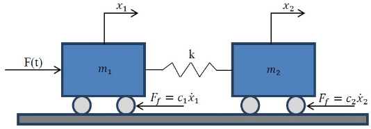

**Extracted Slide/Diagram Text:**
X2
F(t)
mi
m2
Ff= Cixi
F,= C2X2

## Slide 6: Homework (Solutions)


**Extracted Slide/Diagram Text:**
X2
F(t)
mi
m2
Ff= Cixi
F,= C2X2

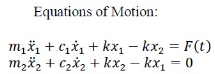

**Extracted Slide/Diagram Text:**
Equations of Motion:
m+c+kx-kx2
Ft)
m2x2+C2x2+kx2
-kxi

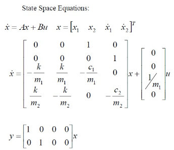

**Extracted Slide/Diagram Text:**
State SpaceEquations:
=A+Bu =[
x+

## Slide 7: Homework (Solutions)

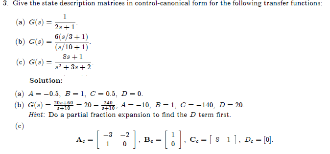

**Extracted Slide/Diagram Text:**
3. Give the state description matrices in control-canonical form for the following transfer functions:
G(8)
2s+1'
6(s/3+1)
(b)
G(3)
(s/10 + 1)
(c) G(s) = 2 + 3s + 2
8s +1
Solution:
(a) A = -0.5, B = 1, C = 0.5, D = 0.
(b) G(s) :
203+60
3+10
Hint: Do a partial fraction expansion to find the D term first.
(c)
-3
-2
Ac
Bc=

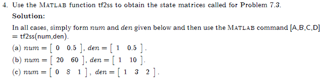

**Extracted Slide/Diagram Text:**
4. Use the MIATLAB
function tf2ss to obtain the state matrices called for Problem 7.3.
Solution:
In all cases, simply form num and den given below and then use the MATLAB command [A,B,C,D]
= tf2ss(num,den),
(a)
0.5.den =
0.51
(b)
60 . den =
(c)
1 den=

## Slide 8: Homework (Solutions)

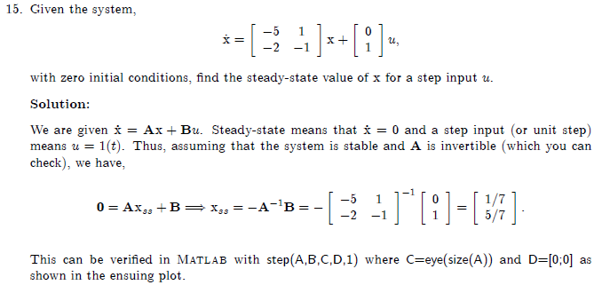

**Extracted Slide/Diagram Text:**
15. Given the system,
x+
-2 -1
with zero initial conditions, find the steady-state value of x for a step input u.
Solution:
We are given x = Ax +Bu. Steady-state means that x = O and a step input (or unit step)
means u = 1(t). Thus, assuming that the system is stable and A is invertible (which you can
check), we have,
- [9]=[/]
0=Axg: +BXss =-A-1B=
-2
This can be verified in MATLAB with step(A,B,C,D,1) where C=eye(size(A)) and D=[0;0])
as
shown in the ensuing plot.

## Slide 9: Homework (Solutions)

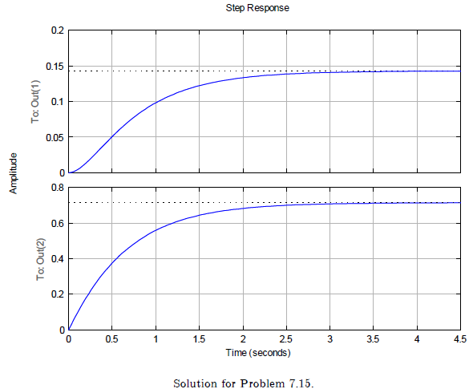

**Extracted Slide/Diagram Text:**
Step Response
0.15
:Out(1)
0.1
0.05
Amplitude
0.8
0.6
To: Out(2)
0.4
0.2
0.5
1.5
2.5
3.5
4.5
Time (seconds)
Solution for Problem 7.15

## Slide 10: Assigment

## Slide 11: Homework (Solutions)

## Slide 12: Homework (Solutions)

Answers

Yes
No
Yes because the unstable pole can be moved
No because not all the poles are allowed to be freely placed

## Slide 13: Homework

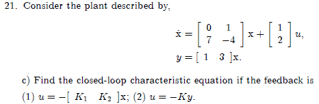

**Extracted Slide/Diagram Text:**
2l. Consider the plant described by,
x=
x+
-4
y =[ 1 3 ]x.
Find the closed-loop characteristic equation if the feedback is
(1)
K2 Jx; (2)
u = -Ki
u=-Ky.

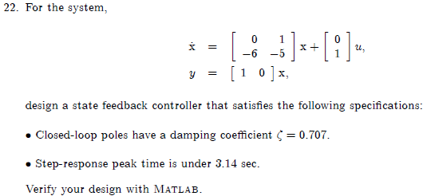

**Extracted Slide/Diagram Text:**
22. For the system
[]
design a state feedback controller that satisfies the following specifications:
Closed-loop poles have a damping coeficient  = 0.7o7.
Step-response peak time is under 3.14 sec.
Verify your design with MATLAB.

## Slide 14: Homework (Solutions)

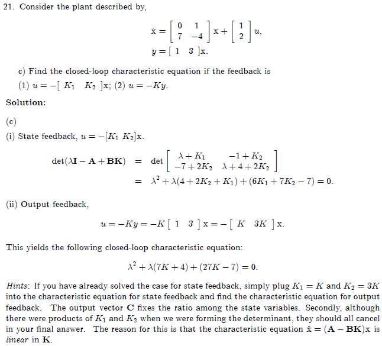

**Extracted Slide/Diagram Text:**
21. Consider the plant described by,
×=[9 24]++[3]
y=[ 1 3 ]x.
c) Find the closed-loop characteristic equation if the feedback is
(1) u= -[ Ki K² ]x; (2) u= -Ky.
Solution:
(c)
(i) State feedback, u = -[Ki K2]x.
^+Ki
-1+ K2
det(I- A +BK) =
det
-7+2K² +4+2K2
^² +>(4 + 2K2 + K1) + (6Ki +7K2 - 7) = 0.
(ii) Output feedback,
u=-Ky=-K[1 3]x=-[ 3K]x.
This yields the following closed-loop characteristic equation:
? + X(7K +4) + (27K - 7) = 0.
Hints: If you have already solved the case for state feedback, simply plug Ki = K and K2 = 3K
into the characteristic equation for state feedback and find the characteristic equation for output
feedback. The output vector C fixes the ratio among the state variables. Secondly, although
there were products of Ki and K2 when we were forming the determinant, they should all cancel
in your final answer. The reason for this is that the characteristic equation x = (A - BK)x is
linear in K.

## Slide 15: Homework (Solutions)

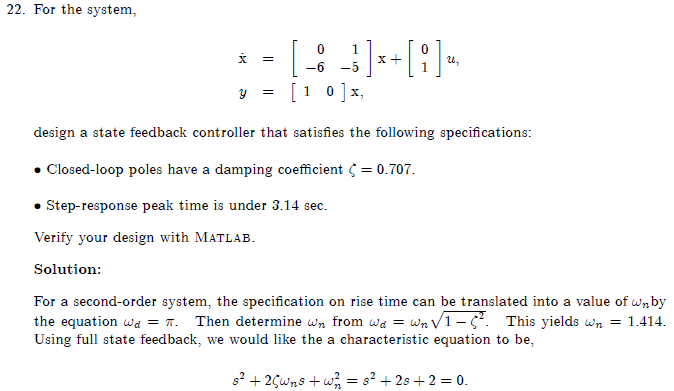

**Extracted Slide/Diagram Text:**
22. For the system,
-6
-5
0x,
design a state feedback controller that satisfies the following specifications:
Closed-looppoles haveadamping coeficient=0.707.
Step-responsepeaktimeisunder3.14sec.
Verify your design with MATLAB.
Solution:
For a second-order system, the specification on rise time can be translated into a value of wnby
the equation Wd = π. Then determine wn from wd = wn V1 -. This yields Wn = 1.414.
Using full state feedback, we would like the a characteristic equation to be,
s² + 26wns +w = s² + 2s +2 = 0.

## Slide 16: Homework (Solutions)

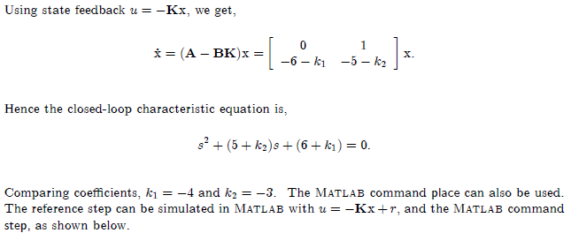

**Extracted Slide/Diagram Text:**
Using state feedback u = -Kx, we get,
x= (A-BK)x=
-5-k2
6-k1
x.
Hencethe closed-loop characteristic equation is,
g? + (5 + k2) s + (6 + k1) = 0.
Comparing coeficients, ki = -4 and k2 = -3. The MATLAB command place can also be used.
The reference step can be simulated in MATLAB with u = -Kx +r, and the MATLAB command
step, as shown below.

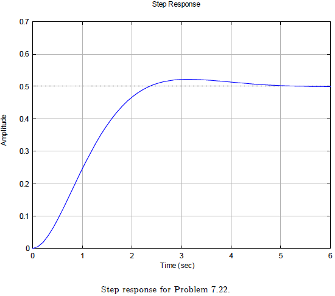

**Extracted Slide/Diagram Text:**
Step Response
0.7
0.6
0.5
Amplitude
0.3
0.2
0.1
Time (sec)
Step response for Problem 7.22.

## Slide 17: Homework

## Slide 18: Solution

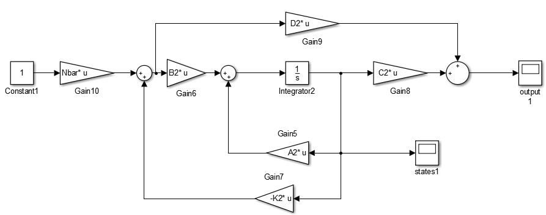

**Extracted Slide/Diagram Text:**
D2*u
Gain9
Nbar* u
B2*u
C2*u
Constant1
Gain10
Integrator2
Gain8
Gain6
output
Gain5
A2*
Gain7
states1
-K2*u

## Slide 19: Homework (Solutions)

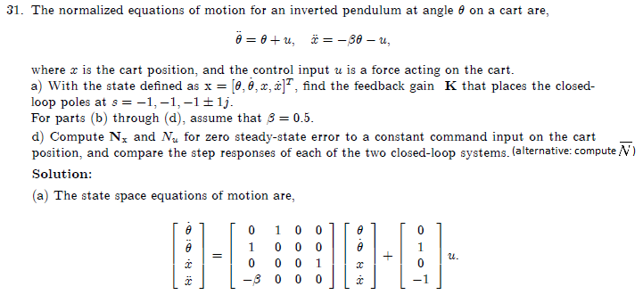

**Extracted Slide/Diagram Text:**
3l. The normalized equations of motion for an inverted pendulum at angle  on a cart are,
= 8 +u, i=-30-u,
where  is the cart position, and the control input u is a force acting on the cart.
a) With the state defined as x = [o, o, &, ], find the feedback gain K that places the closed-
loop poles at s = -1, -1, -1 ± 1j.
For parts (b)through (d),assume that 3= o.5.
d) Compute Nx and Nu for zero steady-state error to a constant command input on the cart
position, and compare the step responses of each of the two closed-loop systems. (alternative: compute N)
Solution:
(a) The state space equations of motion are,
-1

## Slide 20: Homework (Solutions)

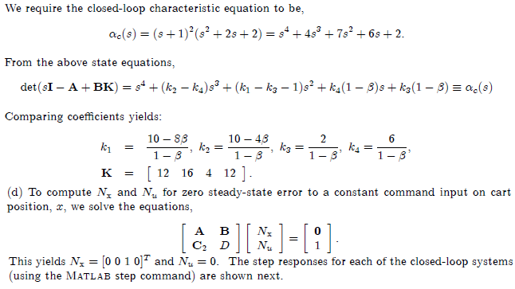

**Extracted Slide/Diagram Text:**
We require the closed-loop characteristic equation to be,
Qc(s) = (s +1)²(s² + 2s + 2) = s* + 4s3 + 7s² + 6s + 2.
From the above state equations,
det(sI - A +BK) = s-+(k2 - ka)s + (ki - k - 1)s-+ka(1 - β)s+ks(1 - β) = αe(s)
Comparing coeficients yields:
10-83
10 - 43
1-β
k2
1-β
164121.
(d) To compute Nx and Nu for zero steady-state error to a constant command input on cart
position, , we solve the equations,
[]-[9]
C² D
This yields Nx = [0 0 1 o]T and Nu = 0. The step responses for each of the closed-loop systems
(using the MATLAB step command) are shown next.

## Slide 21: Homework (Solutions)

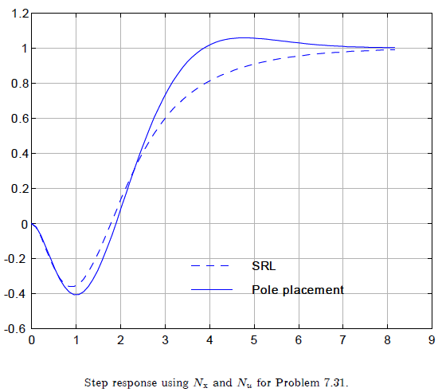

**Extracted Slide/Diagram Text:**
1.2
0.8
0.6
0.4
0.2
-0.2
SRL
-0.4
Pole placement
-0.6
Step response using Nx and Nu for Problem 7.31.

## Slide 22: Homework (Solutions)

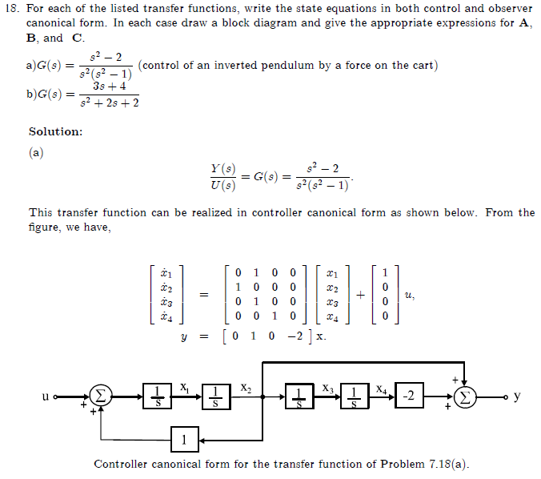

**Extracted Slide/Diagram Text:**
I8. For each of the listed transfer functions, write the state equations in both control and observer
canonical form. In each case draw a block diagram and give the appropriate expressions for A,
B, and C.
g² 2
a)G(s) =
s?(s? - 1)
(control of an inverted pendulum by a force on the cart)
3s + 4
Solution:
(a)
Y(s)
s?-2
: G(s) =
U(s)
32(s? - 1)
This transfer function can be realized in controller canonical form as shown below. From the
figure, we have,
Controller canonical form for the transfer function of Problem 7.18(a).

## Slide 23: Homework (Solutions)

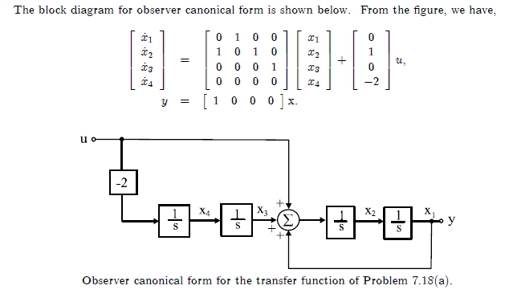

**Extracted Slide/Diagram Text:**
The block diagram for observer canonical form is shown below.From the figure, we have
Observer canonical form for the transfer function of Problem 7.18(a).

## Slide 24: Homework (Solutions)

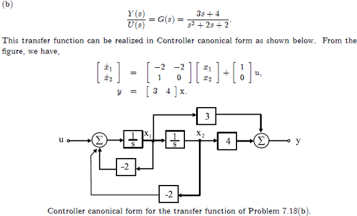

**Extracted Slide/Diagram Text:**
(b)
3s+4
g2+28+2
This transfer function can be realized in Controller canonical form as shown below. From the
igure, we have,
+。
Controller canonical form for the transfer function of Problem 7.1s(b)

## Slide 25: Homework (Solutions)

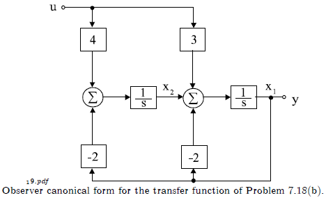

**Extracted Slide/Diagram Text:**
-2
19.pf
Observer canonical form for the transfer function of Problem 7.18(b)

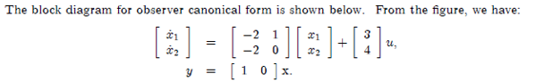

**Extracted Slide/Diagram Text:**
Theblock diagram
for observer
isshown
canonical form
below.
From
the figure, we
have:
-2

## Slide 26: Homework (Solutions)

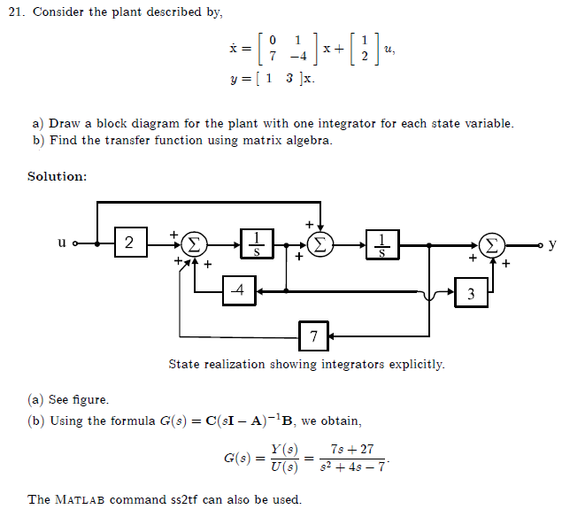

**Extracted Slide/Diagram Text:**
21. Consider the plant described by,
×=[9 -4]++[3]
y=[ 1 3 ]x.
a) Draw a block diagram for the plant with one integrator for each state variable.
b) Find the transfer function using matrix algebra.
Solution:
State realization showing integrators explicitly
(a) See figure.
(b) Using the formula G(s) = C(sI - A)-1B, we obtain,
Y(s)
G(s) =
7s + 27
()n
s2 + 4s -7
The MATLAB command ss2tf can also be used.

## Slide 27: Homework (Solutions)

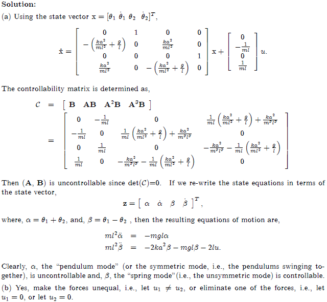

**Extracted Slide/Diagram Text:**
Solution:
(a) Using the state vector x = [81 é1 92 2]T,
ko?
x :
m!
ka?
The controllability matrix is determined as,
AB
m[2
ka?
ka?
Then (A, B) is uncontrollable since det(C)=0. If we re-write the state equations in terms of
the state vector,
z=[]
where, α = Q1 + 92, and, β = 31 - 32 , then the resulting equations of motion are,
ml?α = -mglo
ml' = -2ka²β -mglβ - 2lu.
Clearly, α, the “pendulum mode" (or the symmetric mode, i.e., the pendulums swinging to-
gether), is uncontrollable and, 3, the “spring mode" (i.e., the unsymmetric mode) is controllable.
(b) Yes, make the forces unequal, i.e., let ui  u2, or eliminate one of the forces, i.e., let
ui = O, or let u? = 0.

## Slide 28: Homework (Solutions)

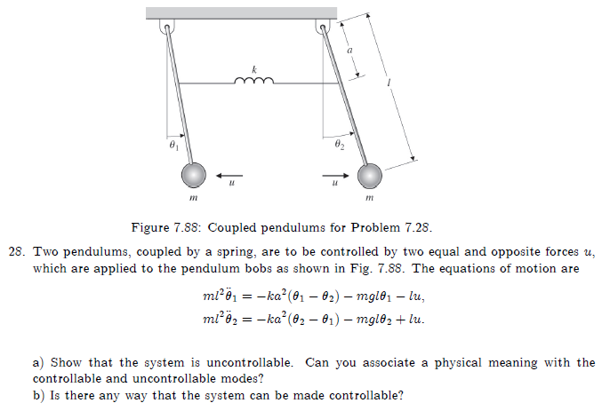

**Extracted Slide/Diagram Text:**
Figure 7.88: Coupled pendulums for Problem 7.28.
28. Two pendulums, coupled by a spring, are to be controlled by two equal and opposite forces u,
which are applied to the pendulum bobs as shown in Fig. 7.88. The equations of motion are
ml?é1 = -ka2(01 - 62) - mgle1 - lu,
ml²82 = -ka?(02 - 01) - mgl82 + lu.
a) Show that the system is uncontrollable. Can you associate a physical meaning with the
controllable and uncontrollable modes?
b) Is there any way that the system can be made controllable?

## Slide 29: Homework (Solutions)

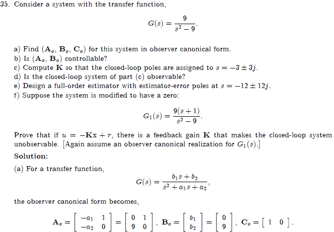

**Extracted Slide/Diagram Text:**
35. Consider a system with the transfer function,
G(s) =
s2 -9
a) Find (A., B., C,) for this system in observer canonical form.
b) Is (Ao, B。) controllable?
c) Compute K so that the closed-loop poles are assigned to s = -3 ± 3j.
d) Is the closed-loop system of part (c) observable?
e) Design a full-order estimator with estimator-error poles at s = -12 ± 12j.
f) Suppose the system is modified to have a zero:
9(s +1)
Gi(s) =
g2-9
Prove that if u = -Kx + r, there is a feedback gain K that makes the closed-loop system
unobservable. [Again assume an observer canonical realization for Gi (s).]
Solution:
(a) For a transfer function,
b18 +b2
G(s)
g? +a1s+a2
the observer canonical form becomes,
C。=「1 0]

## Slide 30: Homework (Solutions)

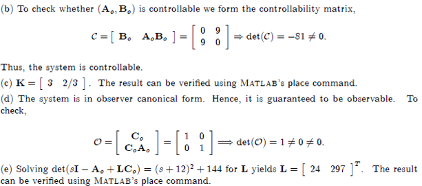

**Extracted Slide/Diagram Text:**
(b)Tocheck whether(A.,B.)is controllableweformthecontrollabilitymatrix,
C=[ B。 A.B。] =
=det(C)=-81手0.
Thus,the system is controllable.
(c)K=32/3TheresultcanbeverifiedusingMATLAB'splacecommand.
(d)The system is in observer canonical form. Hence, it is guaranteed to be observable.To
check,
det（O）=10手0
297 17. The result
can be verified using MATLAB's place command.

## Slide 31: Homework (Solutions)

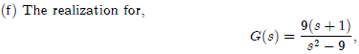

**Extracted Slide/Diagram Text:**
() 1
The realization for,
9(s + 1)
G() :

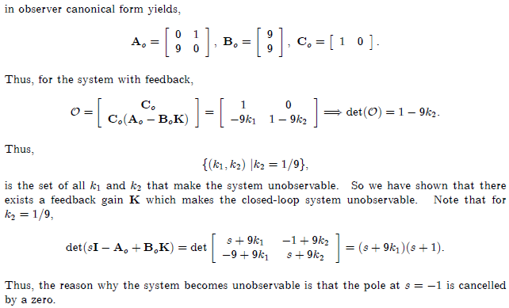

**Extracted Slide/Diagram Text:**
in observer canonicalformyields,
,B。=, C。=[1 0].
Thus, for the system with feedback,
C.
1 - 9k2
C(A.-B.K)
det(O) = 1 - 9k2-
-9k1
Thus,
[(k1, k2) [k2 = 1/9],
is the set of all ki and k that make the system unobservable.So we have shown that there
exists a feedback gain K which makes the closed-loop system unobservable. Note that for
kz = 1/9,
s +9k
-1 + 9k2
det(sI - A, +B,K) = det
-9 +9k1
$+9k2
= (s + 9ki)(s +1).
Thus, the reason why the system becomes unobservable is that the pole at s = --1 is cancelled
by a zero.

## Slide 32: Homework (Solutions)

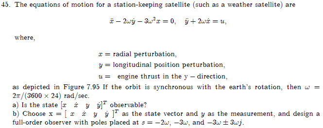

**Extracted Slide/Diagram Text:**
45. The equations of motion for a station-keeping satellite (such as a weather satellite)are
- 2wg-3wα = 0, g+ 2wi= u,
where,
r = radial perturbation,
y =longitudinal position perturbation,
u =
engine thrust in the y - direction,
as depicted in Figure 7.95 If the orbit is synchronous with the earth's rotation, then w
2π/ (3600 x 24) rad /sec.
a] Is the state [c i y y]r observable?
b) Choose x = [  i y y jT as the state vector and y as the measurement, and design a
full-order observer with poles placed at s = -2w, -3w, and -3w ± 3wj.

## Slide 33: Homework (Solutions)

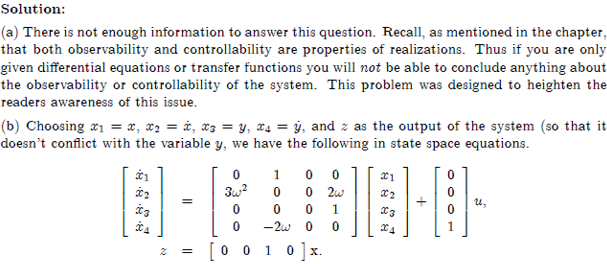

**Extracted Slide/Diagram Text:**
Solution:
a)Thereisnot enough informationtoanswerthis question.Recall,asmentionedinthechapter
that both observability and controllability are properties of realizations. Thus if you are only
given differential equations or transfer functions you will not be able to conclude anything about
the observability or controllability of the system. This problem was designed to heighten the
readersawareness ofthisissue.
(b)Choosing i=,2=,s=y,4=y,and zasthe output of the system (so that it
doesn't conflict with the variable y, we have the following in state space equations.
2w
-2

## Slide 34: Homework (Solutions)

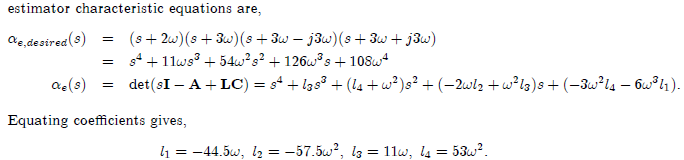

**Extracted Slide/Diagram Text:**
estimator characteristicequationsare
Qe,desired(s)
(s + 2w)(s +3)(s + 3w - j3w)(s + 3w + j3w)
s4 +1lws3 + 54w*s² +126w3s + 108w4
ae(s)
det(sI - A +LC) = s+ + l3s3 +(l4 +w2)s? +(-2wl2 +w-l3)s +(-3w2l - 6w311)
Equating coeficients gives
l1 = -44.5w, l2 = -57.5w², l3 = 11w, l4 = 53²

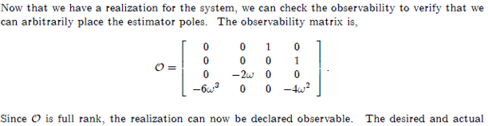

**Extracted Slide/Diagram Text:**
Now that we have a realization for the system, we can check the observability to verify that we
canarbitrarily place the estimator poles.
The observabilitymatrix is.
-2w
SinceO isfull rank,therealizationcan nowbe declared observable.
The desired and actual

## Slide 35: Homework (Solutions)

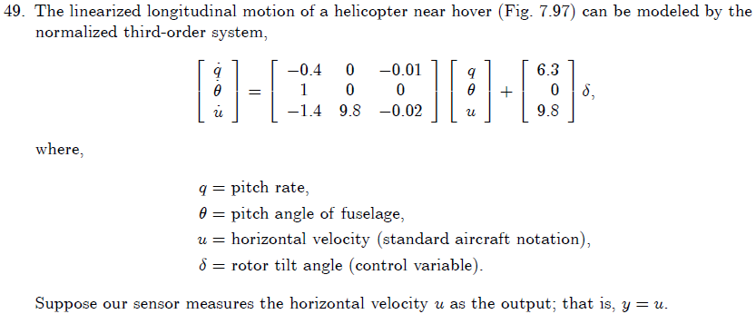

**Extracted Slide/Diagram Text:**
49. The linearized longitudinal motion of a helicopter near hover (Fig. 7.97) can be modeled by the
normalized third-order system,
-0.01
-0.4
q-
6.3
9.8
-1.4
-0.02
9.8
where,
q = pitch rate,
= pitch angle of fuselage,
u = horizontal velocity (standard aircraft notation)
S = rotor tilt angle (control variable).
Suppose our sensor measures the horizontal velocity u as the output; that is, y = u.

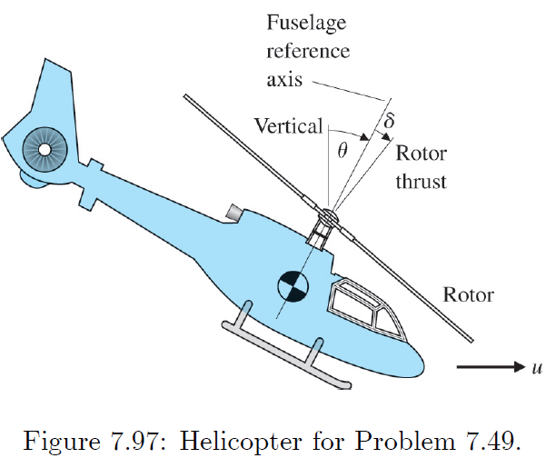

**Extracted Slide/Diagram Text:**
Fuselage
reference
axis
Vertical
Rotor
thrust
Rotor
Figure 7.97: Helicopter for Problem 7.49.

## Slide 36: Homework (Solutions)


**Extracted Slide/Diagram Text:**
Fuselage
reference
axis
Vertical
Rotor
thrust
Rotor
Figure 7.97: Helicopter for Problem 7.49.

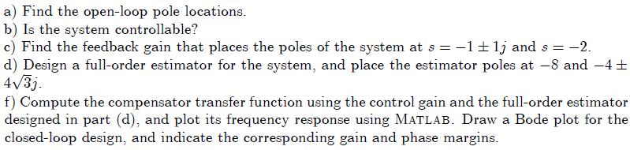

**Extracted Slide/Diagram Text:**
a)
Find the open-loop pole locations.
b) Is the system controllable?
Find the feedback gain that places the poles of the system at s = -l ± lj and s = -2.
d)
Design a full-order estimator for the system, and place the estimator poles at -8 and -4 ±
4V3j.
f) Compute the compensator transfer function using the control gain and the full-order estimator
designed in part
(d), and plot its frequency response using
MATLAB. Draw a Bode plot for the
closed-loop design, and indicate the corresponding
g gain and phase margins.

## Slide 37: Homework (Solutions)

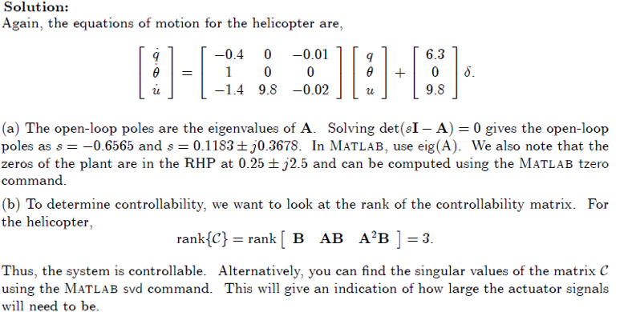

**Extracted Slide/Diagram Text:**
Solution:
Again, the equations of motion for the helicopter are,
-0.4
-0.01
6.3
8.
9.8
-0.02
-1.4
9.8
(a) The open-loop poles are the eigenvalues of A. Solving det(sI - A) = O gives the open-loop
poles as s = -0.6565 and s = 0.1183 ± j0.3678. In MATLAB, use eig(A). We also note that the
zeros of the plant are in the RHP at 0.25 ± j2.5 and can be computed using the MATLAB tzero
command.
(b) To determine controllability, we want to look at the rank of the controllability matrix. For
the helicopter,
rank[C}= rank[ B AB A’B ] =3.
Thus, the system is controllable. Alternatively, you can find the singular values of the matrix C
using the MATLAB svd command. This will give an indication of how large the actuator signals
ill need to be

## Slide 38: Homework (Solutions)

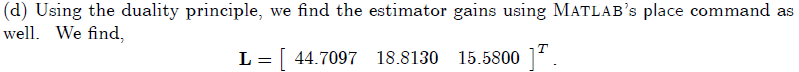

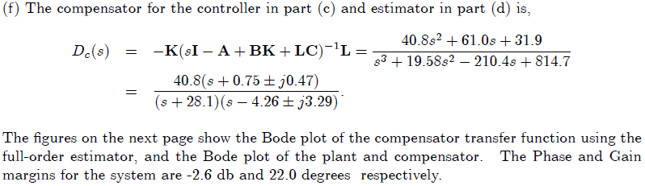

**Extracted Slide/Diagram Text:**
(c) and estimator in part
(d) is,
40.8s2+61.0s+31.9
Dc(s)
-K(sI- A +BK+LC)-IL =
g3 + 19.58s2 - 210.4s + 814.7
40.8(s + 0.75 ± 5j0.47)
(s + 28.1)(s - 4.26 ± 53.29)
The figures on the next page show the Bode plot of the compensator transfer function using the
full-order estimator, and the Bode plot of the plant and compensator.
The Phase and Gain
margins for the system are -2.6 db and 22.0 degrees
respectively.

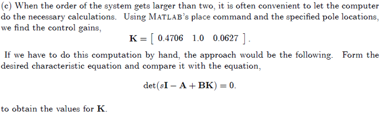

**Extracted Slide/Diagram Text:**
(c) When the order of the system gets larger than two, it is often convenient to let the computer
do the necessary calculations.
Using MATLAB's place command and the specified pole locations,
we find the control gains
K =0.4706
1.0
0.0627
If we have to do this computation by hand, the approach would be the following.
Form the
desired characteristic equation and compare it with the equation,
det(sI - A +BK) = 0
to obtain the values for K

## Slide 39: Homework (Solutions)

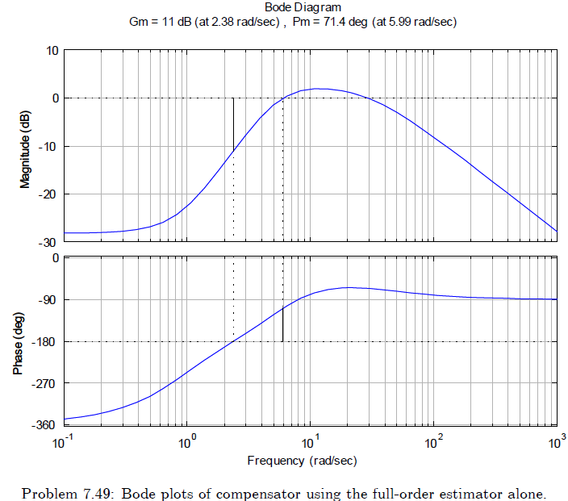

**Extracted Slide/Diagram Text:**
Bode Diagram
Gm = 11 dB (at 2.38 rad/sec) , Pm = 71.4 deg (at 5.99 rad/sec)
Magnitude (dB)
-10
-30
-90
Phase (deg)
-180
-270
-360
10~1
10 1
Frequency (rad/sec)
Problem 7.49: Bode plots of compensator
using the full-order estimator alone.

## Slide 40: Homework (Solutions)

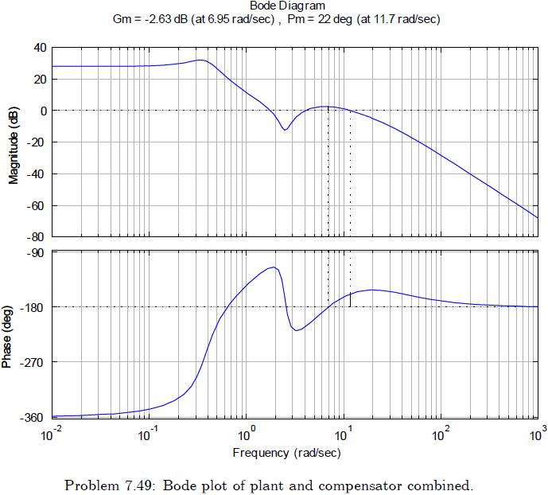

**Extracted Slide/Diagram Text:**
BodeDiagram
Gm = -2.63 dB (at 6.95 rad/sec) , Pm = 22 deg (at 11.7 rad/sec)
Magnitude (dB)
-20
-40
-60
-80
-90
Phase (deg)
-180
-270
-360
Frequency (rad/sec)
Problem 7.49: Bode plot of plant and compensator combined.

## Slide 41: Homework (Solutions)

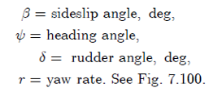

**Extracted Slide/Diagram Text:**
β = sideslip
angle, deg,
沙 = heading
angle,
rudder angle, deg,
rate. See Fig. 7.100.

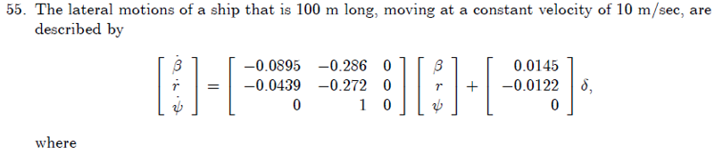

**Extracted Slide/Diagram Text:**
55. The lateral motions of a ship that is 100 m long, moving at a constant velocity of 10 m/sec, are
describedby
-0.0895
-0.286
0.0145
-0.272
-0.0439
-0.0122
where

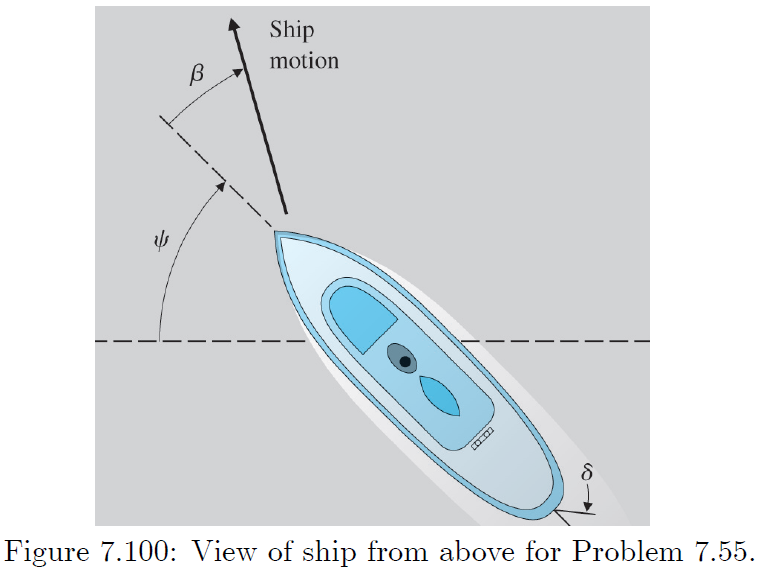

**Extracted Slide/Diagram Text:**
Ship
motion
Figure 7.100: View of ship from above for Problem 7.55.

## Slide 42: Homework (Solutions)

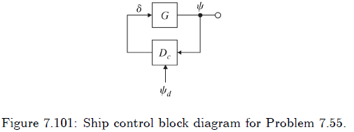

**Extracted Slide/Diagram Text:**
Figure
7.10l: Ship control block diagram for Problem 7.55.

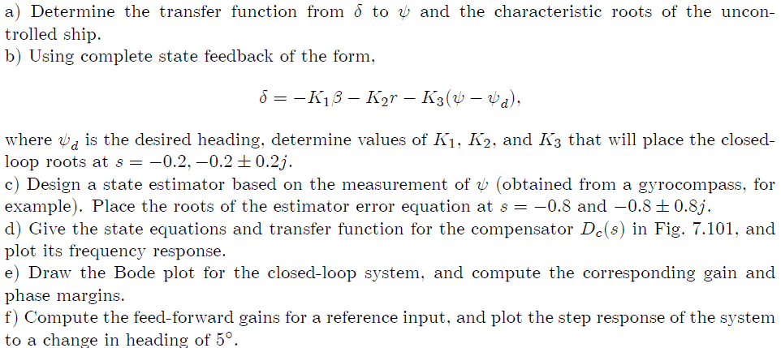

**Extracted Slide/Diagram Text:**
a) Determine the transfer function from  to  and the characteristic roots of the uncon-
trolled ship.
b) Using complete state feedback of the form,
= -Kiβ- K2r-K(-d);
where d is the desired heading, determine values of Ki, K2. and K3 that will place the closed-
loop roots at s = -0.2, -0.2 ± 0.2j.
c) Design a state estimator based on the measurement of z (obtained from a gyrocompass, for
example). Place the roots of the estimator error equation at s = -0.8 and -0.8 ± 0.8j.
d) Give the state equations and transfer function for the compensator De(s) in Fig. 7.1ol, and
plot its frequency response.
e) Draw the Bode plot for the closed-loop system, and compute the corresponding gain and
phase margins.
f) Compute the feed-forward gains for a reference input, and plot the step response of the system
to a change in heading of 5°


**Extracted Slide/Diagram Text:**
Ship
motion
Figure 7.100: View of ship from above for Problem 7.55.

## Slide 43: Homework (Solutions)


**Extracted Slide/Diagram Text:**
Ship
motion
Figure 7.100: View of ship from above for Problem 7.55.

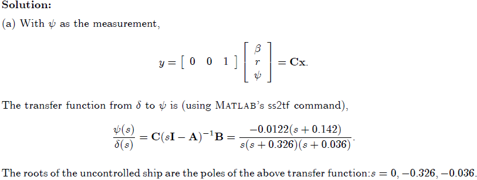

**Extracted Slide/Diagram Text:**
Solution:
(a) With  as the measurement
y=［oo1
= Cx.
The transfer function from S to  is (using MATLAB's ss2tf command)
(s)
-0.0122(s + 0.142)
s(s)
: C(sI-A)-IB:
s(s + 0.326)(s + 0.036)
The roots of the uncontrolled ship are the poles of the above transfer function:s = 0, -0.326, -0.036

## Slide 44: Homework (Solutions)

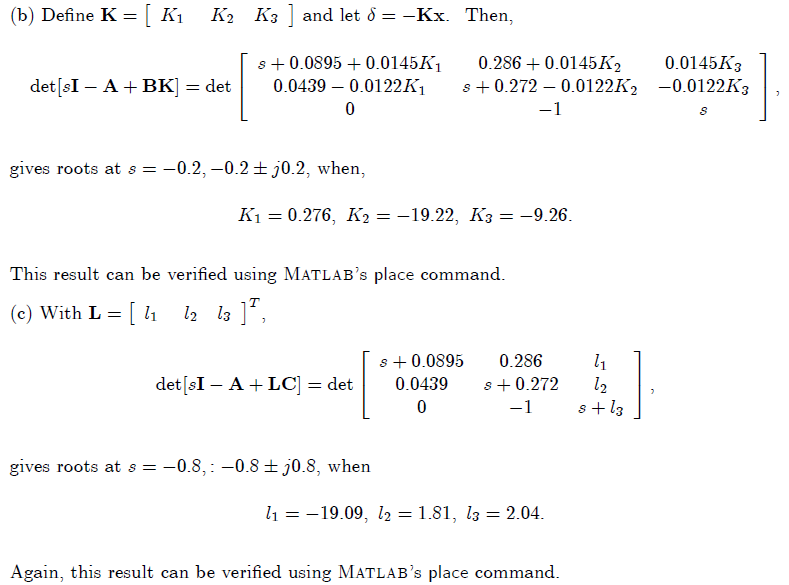

**Extracted Slide/Diagram Text:**
(b) Define K =Ki
K2
K: | and let S= -Kx. Then,
0.286 + 0.0145K2
s + 0.0895 + 0.0145K1
0.0145K3
0.0439 - 0.0122K1
det[sI - A + BK] = det
s + 0.272 - 0.0122K2
-0.0122K3
-1
gives roots at s = -0.2, -0.2 ± j0.2, when,
K1 = 0.276, K2 = -19.22, K3 = -9.26
This result can be verified using MATLAB's place command.
(c) With L=［l² l3 ］′
8 + 0.0895
0.286
det[sI - A + LC] = det
0.0439
$ + 0.272
-1
$+l3
gives roots at s = -0.8,: -0.8 ± j0.8, when
l1 = -19.09, l2 = 1.81, l3 = 2.04.
Again, this result can be verified using MATLAB's place command

## Slide 45: Homework (Solutions)

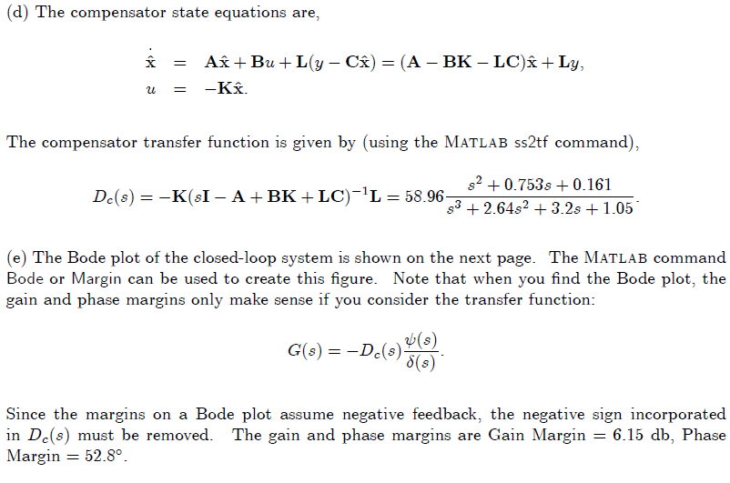

**Extracted Slide/Diagram Text:**
(d) The compensator state equations are,
Ax + Bu + L(y - Cx) = (A - BK - LC)x+ Ly
-Kx.
The compensator transfer function is given by (using the MATLAB ss2tf command):
s2 + 0.753s + 0.161
Dc(s) = -K(sI - A + BK + LC)-1L = 58.96
s3 + 2.64s2 + 3.2s + 1.05
(e) The Bode plot of the closed-loop system is shown on the next page. The MATLAB command
Bode or Margin can be used to create this figure. Note that when you find the Bode plot, the
gain and phase margins only make sense if you consider the transfer function:
G(s) = -Dc(s)
b(s)
(s)
Since the margins on a Bode plot assume negative feedback, the negative sign incorporated
in D.(s) must be removed. The gain and phase margins are Gain Margin = 6.15 db, Phase
Margin = 52.8°.

## Slide 46: Homework (Solutions)


**Extracted Slide/Diagram Text:**
Bode Diag ram
Gm = 15.8 dB (at 1.42 rad/sec) , Pm = 52.8 deg (at 0.334 rad/sec)
Magnitude (dB)
-50
-100
-150
-90
-135
Phase (deg)
-180
-225
-270
10 '3
10°
Frequency (rad/sec)
Problem 7.55: Bode plot of closed-l
svstem for ship control

## Slide 47: Homework (Solutions)


**Extracted Slide/Diagram Text:**
(f) Consider the determination of the feedforward gains Nx and Nu by,
Nu
This gives Nu = O0, Nx = [ 0 0 1 JT. Hence the control becomes,
S = K(NxΦd -x) = KNxd -Kx.
The complete closed-loop system step response is shown on the next page.
The MATLAB
command step can be used to create this figure.

## Slide 48: Homework (Solutions)


**Extracted Slide/Diagram Text:**
Amplit ude (deg)
Time (secs)
Problem 7.55: 5° step response of closed-loop system for ship control.

## Slide 49: Homework (Solutions)


**Extracted Slide/Diagram Text:**
6l. ^ Consider the pendulum problem with control torque Te and disturbance torque Ta:
+40=Tc+Ta
(here g/l = 4.) Assume that there is a potentiometer at the pin that measures the output angle
O, but with a constant unknown bias b. Thus the measurement equation is y =  + b.
a) Take the “augmented" state vector to be
where w is the input-equivalent bias. Write the system equations in state-space form.
Give
values for the matrices A, B, and C.
b) Using state-variable methods, show that the characteristic equation of the model is s(s? +4) =

## Slide 50: Homework (Solutions)


**Extracted Slide/Diagram Text:**
c) Show that w is observable if we assume that y = , and write the estimator equations for
Pick estimator gains [ li l2 l3 jT to place all the roots of the estimator-error characteristic
equation at -10.
d) Using full-state feedback of the estimated (controllable) state-variables, derive a control law
to place the closed-loop poles at -2 ± 2j.
e) Draw a block diagram of the complete closed-loop system (estimator, plant, and controller)
using integrator blocks.
f) Introduce the estimated bias into the control so as to yield zero steady-state error to the
output bias b. Demonstrate the performance of your design by plotting the response of the
system to a step change in b; that is, b changes from 0 to some constant value.

## Slide 51: Homework (Solutions)


**Extracted Slide/Diagram Text:**
Solution:
(a) The system with equivalent input disturbance which replaces the actual disturbance, b, with
the equivalent disturbance w at the control input is.
PL+m+L+eF-
0.
0.

## Slide 52: Homework (Solutions)


**Extracted Slide/Diagram Text:**
(c) Forming the observability matrix, we have,
CA
CA2
-4
Clearly, det(O)= 1  0 so that w is observable. The estimator gains can be determined by
solving,
det(sI - A + LC) = (s + 10)3 = s3 + 30s? + 300s + 1000,
We find that L = [ 30 296 1000 jT. This result can be verified using MATLAB's place
command.
(d) The bias state variable w is not controllable, we cannot move the pole at O. So state feedback
should place the poles at -2 ± 2j and 0. Equating,
det(sI - A +BK) = s(s² + 4s +8),
we find that K = [ 4 4 0 ]. (Note: the zero was chosen arbitrarily).

## Slide 53: Homework (Solutions)


**Extracted Slide/Diagram Text:**
C(sI-A)’B
Baug
aug
Block diagram for Problem 7.61(e)


**Extracted Slide/Diagram Text:**
Ax+BT +CTd,
augx+B
aug
T+ L(y - Cx)
Cx,
Te
-Kx+r


**Extracted Slide/Diagram Text:**
(e) The equations shown in the figure are,

## Slide 54: Homework (Solutions)


**Extracted Slide/Diagram Text:**
ehmaeyanginthebiasfromoat

